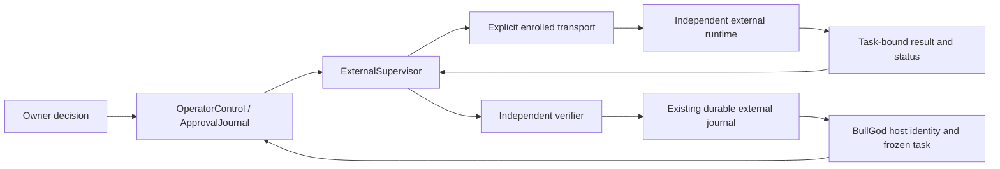

# BULLGOD-COMPUTER-USE-001 architecture

## Decision and scope

Start from `origin/master` `549086e80fb705c3f54037b4fff5c23465dc1490`.
The LIVE-001 / UX-001 merge is `d93a65e4`; UX code is `553413c5`.
Use the separate `codex/bullgod-computer-use-001` worktree. Preserve the original
checkout and both service installations. No deployment, merge, autostart,
service restart, live task, provider change or daily-news change is authorized.

Reuse the existing trusted-host external supervision contract. The minimal
implementation is a deterministic **test adapter**, acceptance tests and this
evidence packet. Do not add an application endpoint, worker tool, adapter
registry, scheduler, personal memory or model loop. A fixture is not a Muse,
Grok Bot or Codex integration. No real engineering-agent adapter is executed.

## Bounded work plan

1. Lead: verify master and merged release; create isolated branch/worktree;
   capture read-only preservation evidence. Do not start an absent service.
2. Luna audit: inspect native browser, MCP, delegation, scheduler, permission and
   external code; write `CAPABILITY-MATRIX.md` with source and test references.
3. Luna discovery: inspect actual Muse/Grok installation metadata and supported
   interface evidence; write the two integration reports. Never inspect personal
   browser sessions or copy credentials.
4. Luna fixture workers: add `tests/test_bullgod_computer_use.py` and bounded
   support if needed, plus `tests/test_bullgod_browser_session_native.py`.
   Use native approval/journal/verifier components and task-owned browser state.
5. Lead: run focused existing external, approval, permission, commitment,
   specialist, discovery and browser/MCP regression tests. Run the opt-in native
   browser fixture separately. Record actual results in `POC-RESULTS.md`.
6. Independent reviewer: one bounded engineering review. Lead resolves concrete
   findings, records the handoff, commits and pushes the requested branch, then
   opens a draft PR. No merge or activation.

All workers are requested as GPT-6 Luna/high. Requested model parameters are not
independent runtime attestation. The lead retains lifecycle and Git ownership.

## Existing data flow

`agent/external/supervisor.py` binds owner, source, conversation, runtime and
supervisor. `contract.py` binds UUID task ID, idempotency key, immutable content,
operation, resource and expiry. External agents keep their own identity,
credentials, model, sessions, memory and implementation. The fixture does not
load BullGod personal memory or schedule anything.

`ApprovalJournal` shares native operator and external tables. Admission checks
current task/enrollment decisions and credential expiry under the SQLite writer
lock, then commits the send intent **before** transport. Repeated submission
returns saved state. A lost reply or interrupted send requires status lookup with
the same task ID. It must never select another adapter or silently retry a send.
An idempotency key cannot be rebound to changed task content.

A real adapter must expose a stable task ID or an idempotency lookup bound to the
request. If it exposes neither, a lost acknowledgement remains Uncertain for
owner reconciliation. Do not invent exactly-once semantics from a click or POST.

## State contract

These labels describe existing durable facts; they do not add a second state
machine. Pre-submission review uses native review packets/operator decisions;
execution uses native external-task observations and verification records.

| Required label | Evidence needed |
| --- | --- |
| Proposed | Frozen bounded task/review packet; no authority implied |
| Awaiting owner approval | Prepared request lacks a current exact task and enrollment approval |
| Approved | Native approval observation is current; real admission rechecks under lock |
| Submitted | Committed send intent plus acknowledged external task; acknowledgement is not a result |
| Running | Fresh authenticated task-bound observation explicitly says running |
| Completed and verified | Completed observation plus independent acceptance and external-state checks pass |
| Failed | Explicit rejection/failure or failed acceptance; execution and verification remain separate fields |
| Uncertain | Lost/ambiguous reply, abandoned intent, unavailable evidence, or unverified completion |
| Cancelled | Confirmed supported termination, or locally confirmed cancellation before send; identify which |

A revoked approval fences the next uncommitted action and records cancellation
intent. It cannot retract an already committed external effect. Cancellation is
not complete until the supported adapter confirms it. Reconciliation can deliver
an existing pending cancellation once; it cannot resubmit the original task.
Historical verified results retain their timestamp and revision. Lost contact
must not be presented as a fresh confirmation of current remote state.

## Adapter choice and fallback

Choose from **observed, authorized** interfaces in this order: authenticated
structured API; supported MCP/CLI; dedicated browser; separate desktop backend.
Prefer Muse when its real contract is available, then Grok Bot. Do not infer
availability from a product name, installed icon, bundled SDK or private internal
endpoint. The discovery reports state which evidence exists.

The deterministic adapter is an explicit test choice, never a silent substitute
for failed real credentials or an uncertain submission. Runtime/provider/model
selection stays with existing components. The existing review schema supports
specific legacy analysis adapters; fixture metadata cannot enroll Muse or Grok.
A real integration requires a reviewed adapter contract and appropriate enrollment
schema before production use. That broader work is not implemented here.

## Browser and desktop boundaries

Reuse `BrowserService`, `BrowserTool` and Playwright. Set a task-owned absolute
`user_data_dir`, a separate screenshot directory, headless mode for fixtures,
and an owned loopback fixture port. Do not attach an arbitrary `cdp_endpoint` or
use an everyday Chrome profile. Native persistence is tested against a task-owned file page with fictional
local storage. An isolated cookie-authenticated HTTP attempt timed out; it is
not accepted evidence of real app authentication.

Native browser support alone does not grant action-level owner authorization.
Restricted workers cannot use browser/MCP tools. Full-access browser dispatch
can perform meaningful page actions, so a future real adapter must gate each
consequential operation against its exact approved request. Approval of a read
must not authorize messaging, publication, purchases, deletion or settings edits.
Do not add blanket shell, network, filesystem or desktop grants to obtain access.

Treat page text, instructions, retrieved results and model claims as data. Check
expected origin, authenticated state, supported operation, task identity and
completion evidence. Stop on unexpected login/approval dialogs, navigation
errors, stale selectors or ambiguous success. Record a bounded error code and
safe task metadata; avoid raw page dumps, cookies, tokens and unrelated content.
An input event or a screenshot alone does not verify an external result.

Native desktop GUI execution is not provided by this POC. MCP can expose a
separate backend only after installation, authentication, scope and actual
server capabilities are verified. No computer-use MCP server is installed or
enabled here.

## Verification and trust limits

The fixture exercises existing `OperatorControl`, `ApprovalJournal`,
`ExternalSupervisor` and `AnalysisVerifier`. Test output is finite fictional data.
The verifier checks a task-bound artifact through the existing read-only
`FileBroker`, including exact computed result and artifact digest. This proves
that contract for a deterministic fixture; it does not prove a real external
service's honesty, hosted availability or human presence at approval time.

Local operator authentication trusts the OS account and root. Existing trusted-
host Python APIs are not an OS sandbox. Native subprocess/browser network calls
need their own confinement; `scripts/ci_test.py` only guards Python sockets.
The accepted browser profile test therefore uses only a task-owned file page,
isolated profiles and fictional storage. The attempted HTTP fixture used only
an owned loopback origin and fictional credentials. No live application service is contacted.

Personal commitments and registered specialist delegation retain their existing
stores, approval boundaries and scheduler. They are checked by focused regression
suites, not connected to the experimental adapter. A future connection must be
separately designed and authorized; no new daily-news action is inferred.
