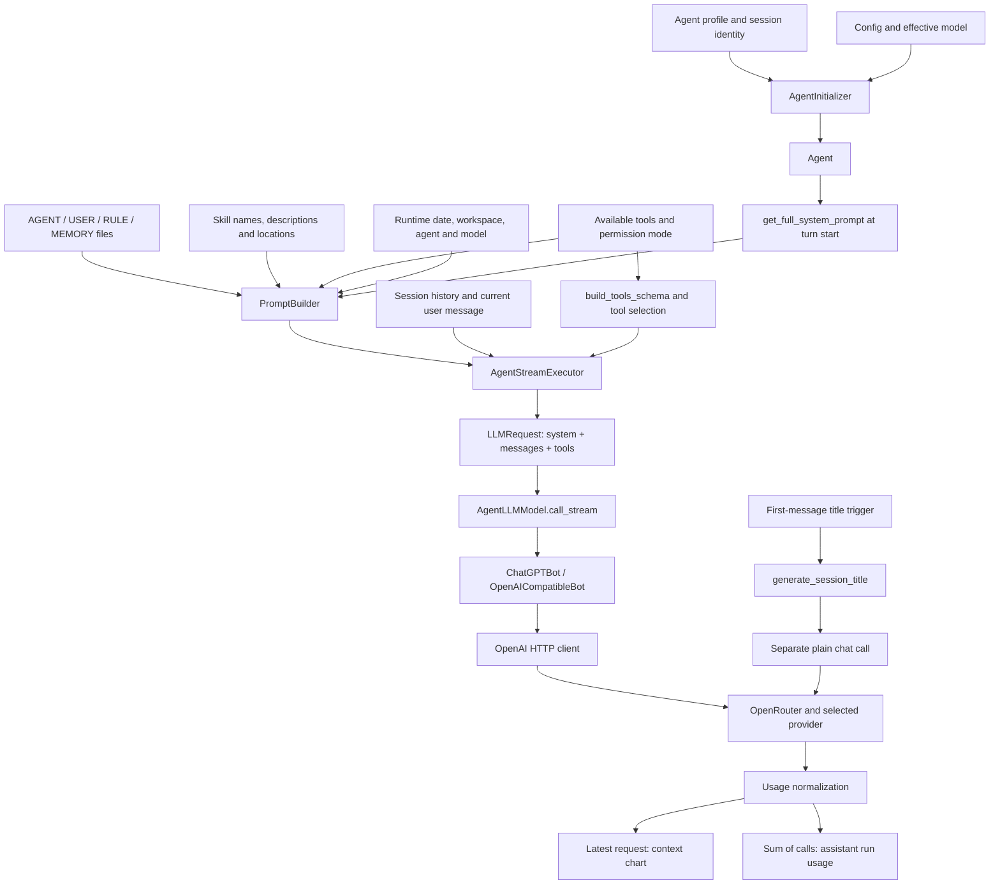

# EFFICIENCY-001: context and caching baseline

Measured 2026-11-06. Production source baseline: `37d947bb`. Audit branch:
`audit/efficiency-001-context-cache`. No optimization or production configuration
change is included. See [sanitized receipts](baseline.json),
[reproduction steps](reproduce.md), and the [proposed implementation plan](implementation-plan.md).

Implementation follow-ups: [Phase 1 accounting](phase1.md) and
[live verification plus Phase 2 description compression](phase2.md), and
[Phase 3 prefix stability](phase3.md). The audit
measurements below remain the historical baseline.

The first memory request is large because CowAgent sends its system instructions
and all 16 built-in tool definitions. The diagnostic estimate omits those tool
definitions. NVIDIA's public chat template estimates **9,961 input tokens**;
OpenRouter reported **9,960**. Tool blocks account for **5,457 estimated tokens
(54.8%)**. This is a model-family estimate, not a provider component breakdown.

Prompt caching worked in this measured sequence: Nvidia reported **8,672 cached
input tokens** on the memory continuation and the identical first-request repeat.
No new cache directives were added. The historical 0% result cannot establish that
the adapter prevents caching. Title generation is a separate call and used
**350 additional tokens**, including 252 reasoning tokens, in this sample.

## Scope and method

The selected model set is the active Nemotron model plus recently used Gemma and
`openrouter/free`. The 410-entry imported catalog and unused GPT-OSS reasoning
override are inventory, not 411 active configurations. GPT-OSS metadata is retained
in the JSON for context; it was not called.

Two SQLite databases were backed up through `mode=ro`, `query_only=ON` source
connections into a private workspace snapshot. Both main-file hashes were
unchanged during backup. CowAgent initialization, maintenance, history reads and
indexed searches ran only against the snapshot. Application logging was disabled.
Credentials were read into memory from the existing config and never changed or
saved in the receipts. No prompt bodies, responses, tool arguments, memory facts
or database rows are published here.

The benchmark invokes the actual prompt builder, tool selection and custom
adapter serialization. It captures the final body, then sends it through a small
HTTP measurement function. It uses the executor's temperature 0 and output-token
policy. It does not start the web server, scheduler or production AgentBridge.
Mocked tests independently verify adapter usage normalization and accounting.
All 16 schemas remain available; only a requested `memory_search` can execute,
against the snapshot. The retained lookup also passed an SQL trace check for FTS
`MATCH`, so the memory evidence is indexed retrieval.

The original complete wire requests were not retained. Historical totals come
from the persisted assistant record; the first input count is inferred from the
run total minus the last-request context count. The new run reconstructs that
task from retained message blocks and current source. It is not a byte-for-byte
replay of the original provider requests.

## Request construction

| Stage | Source and behavior |
|---|---|
| Identity and initialization | [agent_initializer.py](../../bridge/agent_initializer.py#L139) resolves the profile/workspace, memory, tools, skills and history. The initial prompt is built with `language="zh"`. Effective model selection follows initialization. |
| Context files | [workspace.py](../../agent/prompt/workspace.py#L112) loads `AGENT.md`, `USER.md`, `RULE.md`, `MEMORY.md`, then incomplete-onboarding `BOOTSTRAP.md`. Empty/template-only files are skipped. MEMORY uses its last 200 lines, up to 25 KB. |
| Prompt order | [builder.py](../../agent/prompt/builder.py#L126): tooling, skills, memory guidance, knowledge, workspace, permissions, context files, runtime, team, response language. This TestPilot baseline has no team section. |
| Fresh prompt | [Agent.get_full_system_prompt](../../agent/protocol/agent.py#L316) refreshes skills and context files, uses the current UI language and effective permissions, and adds any extra system suffix. This baseline is English with workspace-write permission. |
| History and tool schemas | [agent_stream.py](../../agent/protocol/agent_stream.py#L1706) prepares messages and schemas, then creates `LLMRequest`. Built-in tools are always included. Optional MCP retrieval can narrow MCP tools; this snapshot has no MCP config. |
| Model bridge and adapter | [agent_bridge.py](../../bridge/agent_bridge.py#L503) forwards the request to [OpenAICompatibleBot](../../models/openai_compatible_bot.py#L70) through the custom ChatGPTBot. It converts internal tool-use/result blocks into Chat Completions messages. |
| Usage | [normalization and merge](../../agent/protocol/agent_stream.py#L357) collect input/output/cache counts. `agent.last_usage` stores the latest call; run usage sums calls. The UI's assistant footer uses the run total, not just the last input window. |
| Title | [session_service.py](../../agent/chat/session_service.py#L41) creates a separate plain-chat session with empty system prompt. It can try fallback models if primary title generation fails. These calls are outside agent run usage. |

## Token accounting

All component counts below are local estimates. `cl100k_base` is a cross-model
proxy. The NVIDIA-family column uses the public tokenizer at the pinned revision
in the receipts. Neither column is a billable provider count. Standalone fragment
counts do not necessarily sum to the whole text because boundary tokenization
changes when fragments are joined.

| System component, in sent order | Characters | CowAgent heuristic | cl100k proxy | NVIDIA-family raw text |
|---|---:|---:|---:|---:|
| Tooling guidance | 1,460 | 367 | 332 | 335 |
| Skills catalog and guidance | 2,412 | 606 | 587 | 609 |
| Memory guidance | 1,739 | 447 | 406 | 417 |
| Knowledge guidance | 1,269 | 329 | 290 | 292 |
| Workspace guidance | 2,263 | 583 | 573 | 587 |
| Permission guidance | 459 | 117 | 105 | 111 |
| Context files with wrappers | 7,491 | 1,972 | 1,768 | 1,803 |
| Runtime | 197 | 52 | 67 | 76 |
| Team | 0 | 0 | 0 | 0 |
| Response language | 138 | 36 | 30 | 30 |
| **Whole system prompt** | **17,436** | **4,506** | **4,158** | **4,260** |

The context-file bodies contribute the following subset of the context section.
Their headings, filenames and wrappers are counted only in the section above.

| File body | Characters | CowAgent heuristic | cl100k proxy | NVIDIA-family raw text |
|---|---:|---:|---:|---:|
| AGENT.md | 1,476 | 378 | 349 | 350 |
| USER.md | 507 | 127 | 128 | 135 |
| RULE.md | 4,518 | 1,213 | 1,056 | 1,065 |
| MEMORY.md | 537 | 140 | 135 | 149 |

Tool schema JSON and the provider's chat-template representation differ. The
last column attributes tokens by their starting character offset inside each
function block of the complete public NVIDIA template. This avoids adding
separately tokenized blocks as if their boundaries were identical.

| Tool | cl100k JSON proxy | NVIDIA raw JSON | NVIDIA full-template attribution |
|---|---:|---:|---:|
| read | 294 | 318 | 383 |
| write | 118 | 124 | 160 |
| edit | 229 | 246 | 312 |
| bash | 358 | 383 | 458 |
| ls | 122 | 132 | 168 |
| send | 119 | 124 | 159 |
| search_files | 404 | 437 | 571 |
| env_config | 280 | 301 | 353 |
| scheduler | 773 | 846 | 1,037 |
| web_search | 221 | 243 | 308 |
| web_fetch | 125 | 136 | 155 |
| vision | 105 | 110 | 147 |
| browser | 504 | 543 | 739 |
| time | 96 | 98 | 100 |
| memory_search | 130 | 140 | 195 |
| memory_get | 147 | 159 | 212 |
| **Whole tools / attributed blocks** | **4,012** | **4,342** | **5,457** |

| Input measurement | First request | Reconstructed historical continuation |
|---|---:|---:|
| CowAgent diagnostic estimate | 4,553 | 4,800 |
| Internal history portion of that estimate | 47 | 294 |
| Canonical wire JSON, CowAgent heuristic | 9,374 | 9,618 |
| Canonical wire JSON, cl100k proxy | 8,569 | 8,857 |
| Canonical wire JSON, NVIDIA-family tokenizer | 9,046 | 9,377 |
| Public NVIDIA full chat template estimate | **9,961** | **10,195** |
| Historical provider-derived count | 9,967 inferred | 10,241 from latest context |
| New live provider count | **9,960** | **10,195** from a newly generated continuation |

The local continuation and live continuation have different request hashes even
though their last numbers match. Do not treat that coincidence as exact replay.
The first request and its live repeat have the same hash.

The JSON history components have NVIDIA raw counts of 55 for the initial user
message, 89 for the historical assistant tool call and 241 for its tool result.
These include JSON structure. They are not the provider's rendered message
counts. The first full template has 4,504 tokens outside function blocks; subtracting
the standalone 4,260-token system leaves 244 for messages, template controls and
boundary effects.

Four distinct effects explain the reported discrepancy:

1. The `[Usage]` diagnostic calculates `est_sys + est_hist`; it does not add tool
   schemas. Its 4,553 estimate is 5,407 below the live 9,960 input count. Skills
   already embedded in the system prompt are included in `est_sys`.
2. Character ratios and raw JSON tokenization do not model the provider template.
   The public NVIDIA tokenizer alone leaves a 914-token gap; adding its public
   chat template reduces the first-request difference to one token. The deployed
   provider revision/template remains unverified.
3. The context chart counts cached `Agent.system_prompt`, but the executor receives
   `get_full_system_prompt()`. Rebuilding does not update that field. In this
   snapshot, the cached initial Chinese prompt has heuristic 5,870 versus 4,506
   for the rebuilt English prompt with permission guidance. The chart's comment
   claiming its cached prompt is the sent prompt is stale.
4. Provider input is per request; assistant usage is the sum of the two requests.
   Historical run input is 20,208, while its final input window is 10,241. The
   chart's historical slices (5,130 system / 4,793 tools / 318 history) are scaled
   estimates, not provider component measurements. Its freshness guard checks
   history drift, not system/tool/model fingerprints.

The same schema-budget omission exists in
[`_trim_messages`](../../agent/protocol/agent_stream.py#L2878): its input budget
subtracts system and history estimates without reserving the injected schemas.
No context overflow occurred in this small case; the source-level omission is a
reason to fix accounting before using token estimates to tune longer sessions.

The chart also used a 128,000-token fallback model window. Current OpenRouter
metadata reports 1,000,000 for Nemotron and 262,144 for Gemma. Respecting the user's
configured budget remains a separate requirement; model capacity is not permission
to raise that budget. See [model metadata snapshot](baseline.json) and
[OpenRouter's model API](https://openrouter.ai/api/v1/models).

## Live model comparison

Actual provider counters below include reasoning in output tokens. Durations are
individual request wall times, not statistical performance claims. First delta
time can include a role-only event and is not proven time to first visible token.

| Requested model and call | Actual input | Actual output | Actual cached input | Wall seconds | First delta seconds |
|---|---:|---:|---:|---:|---:|
| Nemotron: first | 9,960 | 83 | 0 | 2.188 | 1.564 |
| Nemotron: continuation | 10,195 | 36 | 8,672 | 2.531 | 2.248 |
| Nemotron: identical first repeat | 9,960 | 83 | 8,672 | 1.560 | 1.036 |
| Nemotron: separate title | 91 | 259 | 0 | 2.173 | — |
| openrouter/free: first | 9,950 | 86 | 0 | 2.665 | 2.335 |
| openrouter/free: continuation | 9,013 | 76 | 0 | 3.194 | 2.041 |
| openrouter/free: identical first repeat | 9,877 | 86 | 0 | 3.041 | 1.994 |
| openrouter/free: separate title | 86 | 86 | 0 | 1.359 | — |
| Gemma: all six attempts | unavailable | unavailable | unavailable | 0.486–1.098 until HTTP 429 | — |

Nemotron completed the two-request indexed-memory task with **20,155 input / 119
output tokens**, 8,672 cached input tokens, and 4.719 seconds of provider request
time. Cache share was 43.0% of the two-call input; the repeated first request alone
had 87.1% cached input. Its title added 91 input and 259 output tokens; 252 of those
output tokens were reported as reasoning. Title usage is not in the 20,155/119.

`openrouter/free` completed the indexed-memory task with **18,963 input / 162
output tokens** and 5.859 seconds of request time. It routed the first call to
`nvidia/nemotron-3-ultra-550b-a55b:free` (Nvidia), the continuation to
`dots-studio/dots-3-note-preview:free` (AtlasCloud), and the repeat/title to
`xingchen-agi/xing4.0-29b-a4b:free` (Phala). These are different models and
tokenizers, so its lower input total is not proof of lower context consumption
for equivalent processing. All its measured cached-token counters were zero.

Gemma returned HTTP 429 for four memory-first requests and two title requests
across two bounded campaigns. No provider usage was returned. The follow-up had
no `Retry-After` header. Successful generation latency, answer quality and caching
remain unmeasured for this model. No further retries were made.

All eight successful responses reported cost 0. This free-model sample supports
no dollar-savings claim. There were 14 requests overall: 11 in the main campaign
and three in the Gemma follow-up. Exact per-call UTC timestamps were not captured
for the first campaign; order, hashes, durations and raw numeric usage were.

## Prefix stability and adapter compatibility

Two same-input rebuilds produced an identical 17,692-byte system prompt. System
and tools were unchanged between first and second requests, and the first message
list was a prefix of the second. This is compatible with reuse. The observed
8,672 cached-token counter is the evidence that reuse occurred in this sequence.

A local next-day literal substitution shortened the common system prefix to
4,663 bytes / 1,096 cl100k proxy tokens because a daily-memory filename appears
early in the memory guidance. The runtime suffix itself already omits clock
seconds. A model-name substitution near the end retained 17,430 bytes / 4,088 proxy
tokens, but cross-model cache sharing must not be inferred. Reordering volatile
date data could preserve more prefix without removing instructions; it has not
been implemented or provider-tested.

| Adapter capability | Finding |
|---|---|
| Full system, history and tool definitions | Forwarded through Chat Completions. Private internal message keys are stripped. |
| Streaming usage | Requests `stream_options.include_usage=true`. |
| Cached input counters | Maps `prompt_tokens_details.cached_tokens` to normalized cache hits; aggregates across calls. Synthetic tests verify this path. |
| Missing cache metadata | Normalizes absence to zero. A displayed historical 0% cannot distinguish missing reporting from reported zero. New receipts retain the raw numeric objects. |
| Cache writes, cost and reasoning detail | Raw response JSON can contain them, but normalized agent usage does not preserve the complete provider detail. |
| Session routing/cache keys | Current request construction does not forward `session_id`, `prompt_cache_key`, `provider` routing options or top-level `cache_control` from call kwargs. No explicit breakpoints are generated. |
| Provider response headers | Application HTTP handling returns JSON/SSE content, not cache response headers. The audit transport records `X-OpenRouter-Cache-Status` separately; it was absent here. |
| Model-specific reasoning | The current adapter's reasoning branch is keyed to particular OpenAI-style names. Do not assume an OpenRouter Nemotron reasoning setting is forwarded. |
| Title usage | The plain-chat title helper returns a title and drops usage from the caller's result. It is outside the agent run total; fallback attempts can add more calls. |

OpenRouter documents automatic prompt caching on supported providers and explicit
controls for others. It exposes cache reads/writes in `prompt_tokens_details`;
`session_id` or `prompt_cache_key` can help route a conversation consistently.
Support and reuse depend on the selected model/provider; a stable prefix alone
is insufficient. These controls are a proposed compatibility improvement, not a
missing prerequisite for this successful Nemotron sample.
[Official prompt-caching documentation](https://openrouter.ai/docs/guides/best-practices/prompt-caching).

Whole-response caching is separate: OpenRouter enables it through request headers
or a preset and reports it in `X-OpenRouter-Cache-Status`. The audit did not enable
it. Prompt cache hits with nonzero usage do not establish whole-response cache hits.
[Official response-caching documentation](https://openrouter.ai/docs/guides/features/response-caching).

The repeated first request follows the memory continuation. This is a measured
sequence, not an isolated experiment that proves cache causality or a cold-cache
baseline. No provider route was pinned, cache TTL measured, or cache eviction
forced. The 0.628-second repeat improvement is an observation from one sample.

## Ranked opportunities — estimates only

| Rank | Proposed change | Estimated benefit | Constraint / risk |
|---|---|---|---|
| 1 | Unify accounting around the sent request; retain usage provenance and separate title usage | 0 token savings by itself; makes later decisions measurable | Preserve existing totals and label estimated component slices. Include schemas in budget accounting. |
| 2 | Shorten repeated prose in scheduler, browser, search_files and bash descriptions | Assuming 20–35% reduction of their 2,805 template tokens: **561–982 input tokens per request**, or **1,122–1,964 per two-call task** | Scenario estimate, not measured. Preserve every parameter, enum, safety rule and capability. Verify tool choice and argument quality. |
| 3 | Keep stable instructions before volatile date/runtime data; add opt-in provider session metadata where supported | **0 input-token removal**; may retain more cache reuse across changes | Date simulation exposes the boundary, not the attainable cached count. Actual price/latency benefit unknown. Avoid changing semantics or default routing. |
| 4 | Bound reasoning for the separate title task where the provider supports it | Scenario range **0–252 output tokens per title** from this sample | Not a guaranteed saving. Keep useful titles, failure handling and user-selected models; validate supported request fields first. |
| 5 | Consolidate repeated tool-use guidance while preserving rules | If 10–20% of the 1,631 raw NVIDIA tokens in tooling/memory/knowledge/workspace guidance can be removed: **163–326 per request** | Requires semantic review. Overlaps with schema edits; do not add both estimates blindly. Do not edit identity or user instruction files without separate authorization. |
| 6 | Extend on-demand discovery to built-in tool schemas | The 14 non-memory function blocks are a **5,050-token ceiling** before discovery overhead | High behavior risk. Not an expected saving or recommendation to disable tools. All capabilities must remain reachable; discovery adds requests and can weaken cache reuse. |

`MEMORY.md` appears once as context-file content. The memory section adds policy
and usage guidance rather than a second copy of its body. Skills already load
their catalog metadata into the prompt and use `read` for full skill instructions
on demand. Removing a supposed duplicate memory body or newly making full skills
lazy would not address the measured baseline. RULE.md is large but user-owned;
its size is not evidence that its instructions are unnecessary.

## Evidence coverage and limits

| Requirement | Evidence |
|---|---|
| 1. Complete construction trace | Diagram and source map; actual builder/adapter capture |
| 2. Estimate discrepancy | Three estimator layers, public chat-template reconstruction, cached-prompt and run/latest-call tests |
| 3. Per-component and per-tool contribution | Tables above; hashes/counts and template token offsets in JSON |
| 4. Stable prefixes | Same-input rebuild, first/continuation comparison, date/model simulations, provider cache counters |
| 5. Adapter caching compatibility | Source map, mocked adapter tests, raw provider numeric receipts, official documentation |
| 6. Redundancy/on-demand candidates | Ranked, bounded scenarios; existing lazy skill loading and single memory body confirmed |
| 7. Extra title calls | Separate live receipts and mocked title-call regression |
| 8. Selected model comparison | Two successful task paths; routing recorded; Gemma availability failure explicitly retained |

This is a baseline, not a model-quality ranking or an optimized implementation.
No production source, identities, instruction files, skills, credentials or active
runtime databases were changed. Full web UI accounting, multimodal prompts, MCP
retrieval, long-history compaction, title fallback costs, provider cache expiry and
successful Gemma generation remain outside the measured cases. The proposed next
phase and its regression gates are in [implementation-plan.md](implementation-plan.md).
