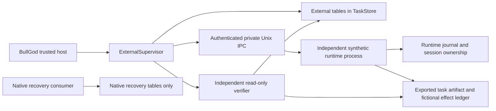

# EXTERNAL-001: external runtime supervision

This milestone implements and tests a **host-only supervisory API and one
synthetic external runtime**. BullGod can submit a bounded task, inspect its
state, request cancellation, retrieve the runtime's result, and independently
check enrolled artifacts/effects. The external runtime remains a separate
process with its own identity, model configuration, session, storage and tools.

Baseline: fork master `e642eec11c4fba1b193d49c7dadb3d02d4667ce0`.
Branch: `feat/external-001-runtime-contract`. No master merge, production
deployment, live agent connection or real provider credential is included.
This is a controlled adapter foundation, not a released Codex/Claude/Gemini/Muse
integration or a new model-accessible delegation tool.

## Existing interface audit

| Existing interface | Finding and integration decision |
| --- | --- |
| [`PeerTransport`, `InvokeRequest`, `InvokeResult`](../../agent/multiagent/transport.py) | Peer directory plus blocking invoke and done/failed result. No authenticated lifecycle, durable idempotency, cancellation confirmation or independent verification contract. Keep this seam unchanged; do not translate external work into a legacy invoke. |
| [`AgentDelegateTool`](../../agent/tools/agent_delegate/agent_delegate.py) | Actual speaker and conversation owner are distinct. Existing roster, depth and authority checks must remain. Remote dispatch is explicitly denied; no external tool is added to restricted workers. |
| [`inbound`](../../agent/multiagent/inbound.py), [`chat service`](../../agent/chat/service.py), [`session service`](../../agent/chat/session_service.py) | Legacy invoke/speak/clear are not a secure external lifecycle. Keep remote authority denial in force and do not offer supervisor control over external private sessions. |
| [`Authority`](../../agent/permission/authority.py), [`FileBroker`](../../agent/permission/filesystem.py) | Native host grants and file checks are enforceable within their documented boundary. External operation grants are a separate explicit enrollment, not a serialized permission-mode string or automatic conversion of a native grant. Reuse the read-only broker for exports. |
| [`TaskStore`](../../agent/recovery/store.py), [`RecoveryService`](../../agent/recovery/service.py) | Existing journal supplies private WAL/FULL transactions and POSIX locks. Native queued records are dispatched automatically. Add separate `external_*` tables to that database; never insert external work into `recovery_tasks`. |
| [`verification`](../../agent/recovery/verification.py) | Reuse frozen criteria and native file checks. A successful response, completed worker or runtime-produced digest cannot substitute for independent observation. |

The [design plan](plan.md) records the alternatives. Extending legacy invoke
would hide required lifecycle states. Embedding another harness as a CowAgent
Agent would transfer ownership that this objective requires it to retain.
The selected API is an opt-in trusted-host service with no global registration,
startup hook, provider calls or import-time listener.

## Architecture and ownership



| Owner | Owns |
| --- | --- |
| CowAgent host | Enrollment and caller authorization; frozen task and criteria; approval attribution; send/cancel intent; authenticated observations; independent verification reports. |
| External runtime | Its name/model configuration, private memory, tools, provider credentials, task-to-session mapping, execution policy and process lifecycle. |
| Operator | Provisioning and revocation of IPC credentials; approval UI/service; runtime start/stop; enrollment of read-only exports; decisions after uncertain effects. |

The shared IPC HMAC key is an enrollment credential, **not a model/provider
credential**. Task messages contain no model selection, session-selection,
private-memory, credential or tool-configuration field. Extra task fields are
rejected. The runtime chooses a fresh session ID, returns public identity/model
metadata in discovery, and retains session IDs across process restart. Host
owner, actual source, conversation, authenticated supervisor and target runtime
IDs are separate. The trusted caller pins these when constructing the supervisor.
This API is not itself a multi-user login or authorization service.

Implementation modules: [contract](../../agent/external/contract.py),
[transport](../../agent/external/transport.py),
[journal](../../agent/external/journal.py),
[supervisor](../../agent/external/supervisor.py),
[verifier](../../agent/external/verification.py),
[synthetic runtime](../../agent/external/synthetic_runtime.py).

## Versioned contract

[contract.schema.json](contract.schema.json) documents envelope, task, approval,
discovery, observation, verification and outcome structures. Its `$defs` are
individually referenceable. Python validators are authoritative for semantic
bindings; JSON Schema alone does not validate an HMAC, current authority,
UTF-8 byte length, task hash or state transition. No schema-validator package
is added. Unsupported versions/actions fail closed.

Protocol: `cow.external/1`. One UTF-8 JSON line per fresh Unix socket connection.
An envelope binds `kind`, `request_id`, `supervisor_id`, `runtime_id`, `key_id`,
`issued_at`, `expires_at`, `action` and complete `payload` under HMAC-SHA256.
The MAC input is Python `json.dumps(..., sort_keys=True, separators=(',', ':'),
allow_nan=False)` with the `mac` field omitted, encoded as UTF-8. Its default
ASCII escaping is part of v1; other language adapters must reproduce these bytes
or negotiate a different canonicalization version. `task_hash` is SHA-256 of
the same canonical encoding of the normalized spec, including both criteria
groups. Times are finite Unix seconds. IDs use the patterns in the schema.

| Operation | Request payload | Successful response data |
| --- | --- | --- |
| `discover` | `{}` | Protocol/runtime ID, public name/model, operations, approval operations, runtime session ownership, cooperative cancellation and boot epoch. |
| `submit` | `{spec, approval}`; approval may be null for an artifact-only task | Task observation; acceptance of the request is not execution completion. |
| `status` | `{task_id, task_hash}` | Current task observation. |
| `cancel` | Same task reference | Observation recording cancellation request or an already terminal task. |
| `result` | Same task reference | Observation including runtime-owned result; may still be nonterminal. |
| Host `verify(task_id)` | No runtime RPC | Independently observed acceptance/state report in the host journal. |

Responses are signed envelopes bound to the exact request ID and action.
Payload is `{ok: true, data: ...}` or `{ok: false, error: ...}`. Error codes are
`invalid_request`, `unauthorized`, `conflict`, `not_found`, `replay`,
`internal_error`. Unauthenticated/expired requests receive no response. The
runtime durably rejects reused request IDs; an idempotent task repeat uses a
new request ID. The transport has no automatic retry.

The synthetic task supports only `write_artifact` and `record_effect`, each with
an artifact basename and fictional text content. Authority contains an allowed
operation list, the exact task UUID as resource namespace and expiry. Operations
must be within enrolled policy; the selected operation must be granted. Export
paths are runtime generated under `exports/<task_id>/<artifact>`; the request
cannot choose arbitrary paths. Directory-relative writes reject symlinks and
use fsync plus atomic replacement. There is no shell/program execution API.

`record_effect` also inserts fictional content into the runtime's `effects.db`.
It requires a trusted-host approval `{task_hash, approved_by, expires_at}` bound
to frozen inputs and expiring no later than the grant. Approval occurs before
send intent; grants, credentials and approval are rechecked before effect
boundaries. `approved_by` is attribution by trusted host code, not a separate
human signature. Native/model workers have no approval tool. A real deployment
must bind this step to its authenticated operator approval system.

## Durable state and recovery

`ExternalJournal(TaskStore(...))` adds `external_tasks`, `external_events` and
`external_verifications`. Existing native tables/rows and memory databases are
untouched. Task identity, normalized specification, idempotency key and approval
are persisted before submission. Events/reports are appended transactionally;
per-task host locks serialize supervising callers. No enrollment secret is
stored in the host journal. Task content and runtime results are journal data:
applications must not put provider secrets into them.

The same immutable key/input returns the same task/session. Changed input
under that key is rejected on both sides. Host send intent and the durable
`submission_started` flag commit **before I/O**. Subsequent `submit` calls do
not transmit again. On host restart, explicit `reconcile()` polls the existing
IDs only. It never submits, retries or starts an external process. Runtime
revision cannot regress, same-revision content cannot change, session/identity
cannot change, and terminal observations are immutable.

| Event/boundary | Required behavior |
| --- | --- |
| Prepared, no send intent | Status/result remain local and do not prevent later submit. Cancellation makes it `cancelled_before_submission`; no runtime task is sent. |
| Host dies after intent, before send | Outcome remains unknown. Even authenticated `not_found` does not permit automatic resend. Operator inspection is required. |
| Host dies after send, before recording response | Query same task ID/hash; recover the runtime observation, without duplicate submission. |
| Runtime disconnect/timeout/bad response | Retain the last valid observation and expose unavailable transport/currentness. Do not infer completion or termination. |
| Runtime dies before effect intent | Its own restart can resume queued work after current authority checks. Session mapping stays stable. |
| Runtime dies after intent or after an effect but before completion | `needs_review`; no automatic effect replay. Artifact and ledger can disagree after a partial execution. |
| Runtime dies after committed completion | Completed session/result retained; no execution replay. Host can independently verify after restart. |
| Credential or grant/approval expiry | New dispatch/effect is denied; status cannot authenticate with an expired credential. Retain uncertainty until operator re-enrollment/reconciliation. No automatic credential refresh. |
| Cancel while running | Durable request; `termination_confirmed` remains false until a terminal observation. Runtime stops at a cooperative boundary. After an effect it can report `needs_review`. |
| Cancel request lost on disconnection | Host retains intent. `reconcile()` polls only; an operator must explicitly call `cancel` again. |
| Verification fails or is unavailable | Execution remains completed and non-replayable. Read-only verification may be repeated; no implicit repair/retry. |

`termination_confirmed` means no more task effects will be produced by that
task execution under the adapter contract. It does not mean the external
runtime server has exited. For a running or disconnected task, requesting
cancellation, receiving a timeout, or losing a socket cannot establish this.
For this fixture, a process-lifetime lock prevents two consumers of one runtime
journal. Real adapters must prove equivalent execution and termination semantics.

## Four distinct outcomes

| Field | Meaning |
| --- | --- |
| `transport_status` | `not_sent`, `sending`, `acknowledged`, `rejected`, `uncertain`, `unreachable`; only the communication/observation layer. |
| `execution_status` | Authenticated runtime state: queued/running/completed/cancelled/failed/needs_review, or host unknown/unsent-cancelled. |
| `acceptance_status` | Passed/failed/unverified under frozen checks, evaluated by the host verifier. |
| `external_state_status` | Confirmed/failed/unverified for the specifically declared independent state checks. |

`verified` requires completed execution, passed acceptance and confirmed state.
`runtime_result` is explicitly labeled `authenticated_runtime_claim`. No runtime
prose, result hash or signed completion alone sets `verified`.

The verifier uses an operator-enrolled export root, the existing read-only
file broker, and native `file_exists`, `text_equals`, `json_equals`, `sha256`
checks. Unknown/missing criteria remain unverified. The fictional ledger check
`synthetic_effect` opens an independently enrolled SQLite path in read-only mode
and compares the task's stored row against caller-frozen expected text. A task
cannot supply a verifier DB path or select executable validation code.

For `record_effect`, declare a `synthetic_effect` check in `external_state` to
confirm that ledger mutation. A file check confirms only the named file; it
does not certify a separate effect. A report binds the spec hash and runtime
revision in the journal and records observation time. It can remain a valid
historical report during a later disconnect; consult `observation_current` and
`verification_checked_at`. Currentness means the last query succeeded, not a
continuous liveness lease. Multiple file/ledger reads are not an atomic snapshot.
The observer verifies persisted state independently of runtime prose; it is not
a cryptographic proof against a malicious runtime forging its own data.

## Security boundary and exposure

- Explicit out-of-band enrollment pins supervisor/runtime/key IDs, at least
  32 bytes of shared HMAC key, expiry and allowed operations. The synthetic
  config and tests use disposable fake values only. Protect a real key outside
  request content; do not commit enrollment files.
- **No TCP listener or external network endpoint.** Client requires a canonical,
  owned private socket parent (0700) and owned private Unix socket (0600).
  Runtime root/export storage is private; a process lock is acquired before
  stale socket replacement. The adapter is POSIX-only and tested on macOS.
- Messages are limited to 1 MiB, task content to 64 KiB UTF-8, signed-message
  validity to 30 seconds (at most five seconds future-clock allowance), server
  reads to three seconds, client I/O to five seconds by default. The server
  limits concurrent connection handlers to 32. These are explicit fixture
  protocol limits, not capacity claims for production workloads.
- Native file verification retains its existing regular UTF-8 text limit and
  symlink/hard-link denial. No native authority allowlist, permission mode,
  model configuration, instruction file or legacy remote denial is weakened.
- Trusted host and runtime code, enrollment paths and the local account remain
  trusted. HMAC authenticates the shared-key peers; it does not isolate mutually
  hostile processes running as the same OS user, encrypt the local channel, or
  authenticate a human approver. No OS sandbox claim is made.
- Runtime task threads, journal retention and replay-ID retention are unbounded
  in this disposable fixture. There is no production admission quota, key
  rotation service, multi-supervisor tenancy, remote discovery, push callback,
  distributed lease or remote-state verifier. Do not expose it as a public daemon.

Duplicate suppression here depends on preserved durable journals/locks and
runtime policy. The fictional effect table also has a unique task primary key.
Filesystem output and ledger insertion are separate commits; a crash can leave
partial state. **No general exactly-once execution or external-effect guarantee
is claimed.** Never delete an uncertain task record to make submission possible.
A later explicit retry/new task can repeat an earlier effect and needs an
operator decision plus service-specific idempotency/reconciliation rules.

## Evidence and reproduction

The [independent review](review.md) found one submission-state defect, now fixed
and regression-tested. The review covered security and architecture together;
its correction check was bounded to that finding.

The three external suites exercise actual socket requests to a separate Python
runtime process. Fixtures strip inherited credentials, use private HOME/data,
fake keys/configuration and disposable SQLite/files. The supervisor crash
fixture is also an owned process killed at actual submission boundaries.
They do not connect real agents or use model services.

Gates passed on 2026-11-07 on macOS/APFS:

| Gate | Result |
| --- | --- |
| Full isolated regression, retained 119 files plus three external suites | **1,388 passed, 15 skipped**, zero failures/errors, 122 files. All 24 external cases pass. |
| Exact seven opt-in native-browser cases | **Seven passed**; IDs match seven skips in the full run. |
| Deduplicated Python total | **1,395 passed, eight Windows-only skips**. Focused and reviewer repeats are not added. |
| Node usage/scroll/message tests | **39 passed**. |
| Strict renderer TypeScript check | **Pass, exit 0**; no strictness/configuration change. |
| Desktop renderer and main build | **Pass**; existing nonfatal warnings remain. |
| Python Ruff F checks and compilation | **Pass**; all 54 retained source hashes are unchanged. New source/fixture/runner hashes are in the receipt. |
| Independent security and architecture review | One P2 corrected and confirmed; no remaining blocker for this synthetic milestone. |

Windows-only path/PowerShell cases are not verified on this host. Linux and
packaged Electron need their own runs; no live channel/provider or production
runtime was exercised. Existing optional font, Browserslist, mixed-import and
bundle-size warnings are preserved in the UI receipt. These limits do not
establish compatibility for a real external agent or remote service.
The 12 new Python files passed fresh Ruff/compilation. Prior compilation
evidence for 54 retained files is reused with every source hash matched.

| Requirement | Authoritative test/evidence |
| --- | --- |
| Discovery, delegation, result retrieval, independent verification, ownership persistence | `test_delegation_preserves_ownership_and_requires_independent_evidence`: public model, stable session/config/private memory, independent report, WAL/FULL/integrity and native recovery queue exclusion. |
| Concurrent requests and immutable keys | `test_concurrent_host_requests_and_conflicting_duplicate`; `test_concurrent_duplicate_and_cooperative_cancel`; `test_duplicate_and_replay`. Real concurrent socket requests; one session/effect, replay nonce rejected. |
| Runtime restart and partial effects | `test_runtime_process_restarts_preserve_effect_boundaries` at before_intent/after_intent/after_effect/after_completion; actual SIGKILL, persisted rows/artifacts and effect counts. |
| Host restart and uncertain send | `test_supervisor_process_death_never_resubmits_uncertain_request` at before_send/after_send; actual SIGKILL and exactly one recorded send intent. |
| Cancellation versus termination/disconnection | `test_cancel_request_is_not_termination_and_disconnect_is_not_death`; paused live runtime remains running until its cancellation boundary. |
| Approval and expiry | `test_enrollment_scope_expiry_and_unsupported_verification`; `test_permission_expiry_while_queued_prevents_effect` for grant and approval. No effect without valid authority. |
| Stale/mismatched identity, wrong/missing artifacts | `test_stale_identity_and_verification_failure_never_trigger_execution`; rejected observations and failed read checks do not cause replay. |
| Authentication and private scope | Contract tests: wrong MAC/request/runtime/action/expiry; actual forged/expired wire requests; runtime configuration overrides and traversal denied; nonprivate socket refused. |
| Review correction | `test_prepare_queries_do_not_poison_submission_and_unsent_cancel_prevents_it`. |
| Existing capabilities, SQLite and Phases 1–4 | Full retained orchestration regression plus external cases, exact native-browser reruns and retained source hashes. |

Commands:

```bash
.venv/bin/python docs/external-001/run_regression.py
.venv/bin/python -m pytest -q tests/test_external_contract.py tests/test_external_runtime.py tests/test_external_supervisor.py
cd desktop
./node_modules/.bin/tsc --noEmit -p tsconfig.json
npm run build
```

The full runner records its private evidence directory and denies connections
except owned HTTP fixtures and each external test's exact private Unix socket.
It retains the prior release test selection. Native-browser opt-in cases use
fresh profiles and local file fixtures; exact IDs are deduplicated in the report.
The standalone fixture CLI is only for owned disposable directories; the tests
show provisioning and guaranteed process cleanup. No global daemon is installed.

Gate receipts and final totals are recorded in [regression.json](regression.json)
and [ui-gates.json](ui-gates.json), with raw [output](regression-output.txt) and
[JUnit](regression-junit.xml). Source hashes bind receipts to the tested files;
overlapping focused/reviewer runs are not counted again. The existing
[icon rendering evidence](../channel-icon-typecheck/README.md) applies unchanged;
strict renderer and build are checked again for this branch.

## Recommendations before real-runtime integration

1. Select one runtime and document its native task/session/result and stop
   semantics from its official API. Implement a versioned operation mapping;
   do not pass raw unrestricted commands through this synthetic contract.
2. Add authenticated operator approval and enrollment/key lifecycle with caller
   authorization. Keep BullGod's authority intersected with receiver policy.
   A directory entry or a worker-provided identity is not authorization.
3. If cross-host operation is needed, add an explicitly configured authenticated
   and encrypted transport with identity binding, replay limits and revocation.
   Do not expose this Unix fixture through an unauthenticated proxy.
4. Define service-specific idempotency, durable acceptance, cancellation and
   uncertain-effect reconciliation. Keep polling distinct from resubmission.
   Add capacity/retention policy and migration tests before long-lived use.
5. Enroll independent service observers for the intended effects. Runtime
   assertions or local artifacts cannot prove a remote email, purchase or deploy.
6. Repeat failure-boundary and compatibility gates for that adapter and target
   OS. Only then consider a host UI/tool gateway, with unchanged restricted
   worker boundaries and explicit operator authorization for live connections.

No production migration or existing task repair is performed here. Preserve
both journals and their WAL companions outside file-sync conflict handlers.
Removing the opt-in external integration leaves existing native behavior intact;
do not drop journals as rollback. Before any separate deployment, inspect
uncertain external tasks and the existing orchestration release limitations.
