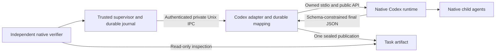

# EXTERNAL-002B: bounded supervisory runtime integration

**Decision: MERGED for the enrolled read-only analysis and artifact contract.**
The owner authorized integration after the completed
[merge review](merge-review.md). Production orchestration remains inactive.
Other operations and untested runtime configurations remain unsupported.

CowAgent now supervises a real Codex runtime through the EXTERNAL-001 contract.
It delegates a bounded business-analysis task, keeps durable identity and
progress, requests cancellation, preserves uncertainty, and independently
verifies a resulting JSON artifact. Codex owns its model, authentication,
instructions, memory, sessions and internal delegation. CowAgent does not
perform the delegated reasoning or replace Codex's internal agent manager.

The feature branch started from `26c8e77d`. EXTERNAL-001 `bfd64e39` and its
evidence remain in the ancestry. Fork master was fast-forwarded from `e642eec1`
through merge approval `e5b2fca5`; product source still matches reviewed
`bc88ca4b`. No production worker registration, endpoint or activation was added.
The integration is explicitly constructed by trusted host code and is a possible
foundation for BullGod. EXTERNAL-003 continues on a separate development branch.

## Disposition of the previous blocker

The [EXTERNAL-002 report](../external-002/README.md) recorded an unexpected
collaboration advertisement while two feature flags were false. That observation
did not demonstrate an escape. Requiring all internal delegation to disappear
was too narrow for the supervisory objective. The failed source-edit test also
did not establish whether supervision of an analysis task could work.

Two new real probes permitted native delegation under the enrolled read-only
profile. Codex created one child in each probe. Public `subAgentActivity`
events supplied the child IDs, and public `thread/read` results established
`parentThreadId` and `source.subAgent.thread_spawn.parent_thread_id`. Each child
attempted one explicitly authorized negative write: one outside the workspace,
one inside it. Native `fileChange` events reached approval, the host declined,
the native result was `declined`, and independent checks found no marker file.
This establishes actual execution, native parentage and the observed approval
boundary; it does not infer safety from a model choosing not to try a write.

The observed collaboration path is therefore supported for this bounded native
task. The prior flag behavior is not treated as an authority violation. The
new probes retained native delegation settings; they do not prove what every
legacy flag combination does. Official documentation states that native children
inherit sandbox and approval settings and cannot replace those settings through
custom-agent configuration. [Codex subagent controls](https://learn.chatgpt.com/docs/agent-configuration/subagents#approvals-and-sandbox-controls)

An additional correction: `experimentalRawEvents` is marked internal-only in
the installed schema. Historical EXTERNAL-002 captures remain diagnostic
evidence, but the adapter does not use that option. It uses public lifecycle,
collaboration and history interfaces. The deprecated `multiAgentMode` field is
not a capability control. [Public app-server interface](https://learn.chatgpt.com/docs/app-server)

See [authority-probes.json](authority-probes.json) for the exact native events,
parentage, denial results, configuration fingerprints and limits. Root and
child session IDs differed in the observed runtime. The adapter records them
separately and uses explicit native parentage to identify children.

## Supported supervisory contract

The new operation is `analyze_records`. It accepts one immutable JSON dataset:
USD, 1–100 records, identifier-like record IDs, signed integer cents, and
`paid`, `refund`, `pending` or `void` status. Exact input fields and bounded
values are validated before dispatch. Arbitrary prompts, paths, commands,
runtime sessions, model settings and credentials are not task parameters.

The objective defines signed totals, first-occurrence duplicate handling,
excluded void records and invalid-sign exceptions. Codex returns JSON through
the public `turn/start.outputSchema` interface. Trusted host code publishes the
actual returned bytes once under `exports/<task-id>/<artifact-name>`; it does
not replace an incorrect result with expected values. The native runtime has
read-only filesystem authority. This host artifact is the operation's only
permitted external effect.

An independent `AnalysisVerifier` reads the actual artifact through the native
read-only `FileBroker`. It checks exact JSON structure/types, arithmetic,
exceptions, task ID, dataset digest, artifact name and runtime-result hash.
Explicit caller verification criteria are also checked: a failed or unsupported
criterion cannot be silently dropped. No model-generated code or test is run.

| Requirement | Adapter mapping and guarantee |
| --- | --- |
| Discovery | Installed CLI/version, effective public config/features/profile and enrolled model/provider metadata; no model turn needed |
| Task authority | Explicit `analyze_records` credential grant, task namespace and expiry; read-only native profile, network-disabled command sandbox, external services disabled, escalation declined |
| Submission | Authenticated private Unix IPC; immutable spec/hash; durable adapter identity and native thread/session/turn mapping; send intent committed before `turn/start` |
| Idempotency | Same immutable task returns its prior identity; conflicting idempotency input is rejected; no native resend after intent |
| Progress | Public native lifecycle and child events; sanitized item counts and IDs; no reasoning or instruction text in journals |
| Internal delegation | Native ownership/parentage observed where exposed; host does not schedule or select models for individual children |
| Cancellation | Durable cancellation/publication fence before bound `turn/interrupt`; explicit repeat can resend a lost interrupt; polling never retries it |
| Results | Actual native final message, host artifact name/hash and separate execution, acceptance and state-confirmation results |
| Supervisor restart | Reopen durable host journal and query the existing runtime task; no resend after uncertain acceptance |
| Adapter restart | Retain task/native IDs and query existing public history only; never resume a native turn or republish an uncertain artifact automatically |

Wire protocol remains `cow.external/1`; adapter metadata is `cow.codex/1`.
`analyze_records` is an explicit capability extension. Existing default
credentials still grant only the two legacy operations. The synthetic runtime
rejects analysis enrollment. Existing approval, isolation, recovery and
verification semantics are retained. The [extended wire schema](contract.schema.json)
documents the added operation; the original EXTERNAL-001 schema is retained as
historical evidence. Python validation also enforces semantic and cryptographic
bindings that a structural JSON schema cannot establish.

## Architecture and enrollment

Implementation: [CodexRuntime](../../agent/external/codex_adapter.py),
[CodexAnalysisPolicy](../../agent/external/codex_policy.py), and
[analysis/verifier](../../agent/external/analysis.py). The existing supervisor,
journal and authenticated IPC remain the integration boundary. No unrestricted
command interface was added to CowAgent's restricted workers.

Enrollment is off by default. Trusted operator metadata binds the tested CLI,
model/provider, policy revision, retained authority-probe digest, provider
configuration digest and complete native configuration digest. Every new task
also checks the effective read-only profile, exact filesystem/network rules,
approval route and disabled service surfaces. Extra layered grants or config
drift fail closed. Enrollment is evidence for a tested configuration, not a
continuous universal runtime guarantee or an authentication service.

The tested configuration is macOS/arm64, Codex CLI 0.165.0, native selected
`gpt-6-astra` / `codex-pooler-ws` / `ultra`, with existing ChatGPT authentication.
CowAgent did not set those selections. It did not change Pooler configuration,
copy native credentials or substitute instruction text. Existing memory use
remained enabled; per-invocation memory-generation input was disabled for the
fixture. No existing memory/history was deleted. Fresh native task history
remains owned by Codex. [Native memory controls](https://learn.chatgpt.com/docs/customization/memories#configure-local-memories)

Per-invocation project trust avoids the earlier native global-config write.
The full config hash was identical before and after both authority probes and
the complete native acceptance run. Temporary policy overrides were not saved
to the native config. All CowAgent journals and test records were disposable.
[CLI configuration overrides](https://learn.chatgpt.com/docs/config-file/config-advanced#one-off-overrides-from-the-cli)

## Execution, verification and cancellation evidence

The [native receipt bundle](native-receipts.json) contains actual runtime IDs,
authenticated observations, independent verifier reports and source hashes.
The primary run used **three real root turns**, plus two earlier authority
probe root turns with two observed native children. It passed on its first run.

| Scenario | Evidence and result |
| --- | --- |
| Successful analysis | Seven fictional records; four accepted; paid 15,500 cents, refund −2,500, pending 8,000, net 13,000; all three exceptions correct |
| Independent artifact confirmation | Execution initially completed/unverified; independent read then passed acceptance and confirmed artifact state |
| Duplicate and uncertain host acceptance | Actual supervisor subprocess killed with SIGKILL after runtime acceptance but before host observation; new supervisor recovered the same task/session; native history showed exactly one original turn |
| Incorrect output despite completion | Owned completed artifact was changed; verification failed and another submit did not create a turn. This is deliberate artifact tampering, not a claim that Codex spontaneously produced wrong arithmetic |
| Wrong arithmetic with matching runtime hash | Separate deterministic fake-runtime tests reject wrong calculations, schema, exceptions and bindings even when the runtime claims completion |
| Real cancellation | Waited for native model reasoning activity; first cancel response remained running/unconfirmed; later native interruption plus publication fence confirmed scoped cancellation; no artifact existed |
| Runtime interruption/restart | Cooperative SIGTERM after native model activity; restart retained IDs and the one interrupted native turn; no new turn or artifact |
| Missing Codex | Separate fixture with a nonexistent executable returned authenticated unavailability and failed before dispatch; installed Codex was not changed |
| Consequential action outside grant | `record_effect` rejected by the analysis runtime even with a claimed approval; native child write canaries separately reached and were denied at the approval boundary |
| Uncertain native dispatch/publication | Deterministic timeout, EOF and publication-acknowledgement-loss fixtures retain uncertainty and never replay |

The [verified artifact](artifacts/verified-report.json) preserves the exact
native bytes from the completed turn, with SHA-256
`9f7c52a8108e7508168ebf22a11f73e58638277514fe060ea97587635f69b005`.
Its [input](artifacts/records.json) and [per-task schema](artifacts/report.schema.json)
are published. This artifact snapshot predates the deliberate private-fixture
tampering. Verification is time-bound; later mutation invalidates that state.

`termination_confirmed` retains the EXTERNAL-001 meaning of no further enrolled
task effects. For this operation, it requires the constrained native authority
and durable host publication fence/seal. It **does not mean every native child
process exited**. Root-turn interruption, task-artifact quiescence and descendant
exit are separate facts. Every result keeps `termination_scope` and
`descendants_terminated` explicit. Unknown native or publication outcomes stay
nonterminal; a missing connection is not proof of death. The deadline requests
interruption cooperatively and is not a hard cost or resource ceiling.
[Native interruption API](https://learn.chatgpt.com/docs/app-server#interrupt-a-turn)

## Quality gates and independent review

| Final gate | Result |
| --- | --- |
| Complete applicable Python regression | 1,449 passed, 15 skipped; 127 files, 1,464 unique JUnit IDs |
| Seven exact browser cases rerun separately | 7 passed; deduplicated total **1,456 passed, 8 Windows-only skips** |
| New analysis, adapter and policy suites | 44 passed, included above |
| Node UI suites | 39 passed |
| Strict renderer TypeScript | Passed with strictness unchanged |
| Desktop build | Passed; existing non-fatal warnings retained |
| Static checks | Ruff F and in-memory compilation passed for 10 changed/new Python files; 68 unchanged source hashes matched retained static evidence |
| Actual Codex adapter and authority tests | Passed; independently checked artifact, child denials, cancellation and restart receipts |
| Independent engineering review | No remaining blocking finding for the enrolled operation |

The [review](review.md) found three concrete issues, all fixed with regressions:
layered authority/configuration drift, suppression of an explicit repeated
cancel, and inconsistent artifact identifier length. Independent narrow
confirmation passed all four correction tests. A timing-sensitive regression
was corrected to poll through synchronized status access.

The first full regression exposed a fixture integration error: its private Unix
socket had not been enrolled in the retained network guard. The fixture now
allows only its exact owned socket and preserves the outer guard. No product
permission or test network restriction was weakened. Final full-suite counts,
the initial failure history, JUnit and source/static checks are in
[regression.json](regression.json), [JUnit](regression-junit.xml),
[output](regression-output.txt), and [UI/browser gates](ui-gates.json).

The gates include SQLite/WAL/indexed memory, efficiency Phases 1–4, isolation,
recovery, verification, external-runtime contracts, adapter fixtures, UI tests,
strict renderer TypeScript, desktop build and static analysis. Former renderer
type errors are not waived. Platform skips and existing build warnings remain
explicit in the receipts.

The opt-in [native runner](run_native_acceptance.py) requires `--execute` and an
absolute enrolled CLI path. It refuses configuration drift, creates private
fixtures, saves per-case receipts and closes owned processes. Repeating it
creates new native test history and uses the existing native authentication;
it is not part of the offline regression suite.

## Unsupported operations and next milestone

- Arbitrary code execution, code editing, browser/service actions, general file
  mutation, production data and remote-service effects are outside this grant.
- No production approval UI/service, key rotation or native restricted-worker
  entry point is installed. Escalations are declined, not automatically granted.
- Native children are observed where public events/history expose them. Full
  descendant exit, provider-side compute cancellation, billing limits and hard
  memory/CPU ceilings are not proven. The native concurrency setting is recorded,
  not presented as a measured universal ceiling.
- Runtime/configuration upgrades or a changed provider require fresh enrollment
  evidence. Other platforms are unverified. Runtime retention, worker counts
  and the client event queue still require production limits and maintenance.
- After uncertain dispatch or publication, only history is reconciled. Automatic
  result reconstruction/publication and automatic uncertain retry are unsupported.

The next integration milestone should add an operator-facing enrollment and
approval flow for this already bounded operation, credential rotation/retention,
and explicit uncertainty-resolution controls. Keep external-service mutation
behind a separate authority and independent-effect verification gate. No
self-evolution or broader tool discovery is introduced by this change.
