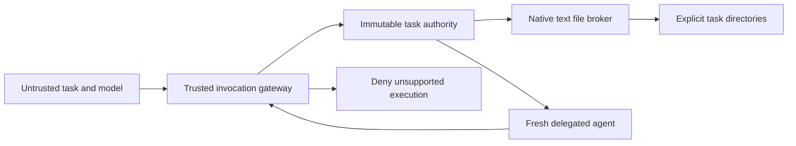

# ISOLATION-001: restricted worker authority

Status: **verified restricted mode**, with 1,294 passing regression tests. This is
the brief's **fail-closed restricted-mode deliverable**, not hard OS isolation.
No production deployment or master merge is authorized by this document.

Baseline: `master` at `c2c39a2e`; audit documentation at `06e0a4dd`. Work is on
`fix/isolation-001-worker-authority`. The reference audit is
[ORCHESTRATION-001](../orchestration-001/README.md).

## Threat model and scope

An untrusted model, prompt, task body or MCP schema can request tool names,
arguments, paths and delegation. It must not acquire authority by choosing a
different tool, changing a name, asking a child, or causing a check to fail.
Protected assets are sibling/parent private files, credentials, persistent
history and memory, executable host state, and the host's process authority.

The trusted computing base is CowAgent's Python host, native broker, model
adapter, operator configuration and installed code. Host-owned model clients
retain the credentials needed for the assigned provider request. Those clients
are not exposed through worker tools or environments. A granted task directory
must contain material the operator intends to share. This contract cannot
identify arbitrary secrets placed inside an explicitly shared ordinary file.

Malicious installed Python extensions, native parser exploitation, a hostile
same-user process changing mounts/directories, a compromised kernel or the
operator explicitly running a full-access host tool are outside this boundary.
The restricted mode does not run arbitrary worker code at all. Public raw
`Tool.execute` methods remain trusted-host implementation APIs; model, wrapper,
post-process and scheduler dispatch must use the authorization gateway.

## Vulnerabilities and causes

| Finding | Baseline cause | Enforcement change |
| --- | --- | --- |
| Authorization exception allowed execution | `AgentStreamExecutor._permission_denial` returned no denial on errors or missing agent | Errors and unknown implementations deny before invocation |
| Unknown tools acquired authority from names | `policy.check_tool_call` implicitly allowed remaining tools | Exact native implementation descriptors; unknown/MCP descriptors deny, including full-access |
| Python through Bash escaped workspace writes | Shell-string policy could not constrain program effects | Restricted Bash, Python, background/status/kill and external execution denied |
| Child could query parent memory | Shallow tool copies retained the parent's manager | Fresh native tools, no memory/skill/browser/MCP manager copies |
| Receiver initialized with private context | Persistent initializer/history loading preceded inherited mode | Separate fresh restricted Agent, no persistent runtime initialization |
| Worker picked up global MCP resources later | Streaming hot reload reattached tools after child construction | Worker hot reload disabled before ToolManager access |
| Scheduler bypassed streaming policy | Direct tool implementation dispatch | Legacy tool-call route denies before tool construction |
| Corrupt settings retained stale authority | Store/bridge reads swallowed errors | Strict authority-setting reads and sanitized failure before model execution |

These are high-priority confidentiality/integrity risks: a normal model tool
request could exercise them, without an OS exploit. Configuration and installed
host code remain trusted; remote peers are denied rather than trusted to assert
their own capability envelope.

The baseline was reproduced in a detached disposable checkout at `c2c39a2e`,
using the original audit's actual Agent, SubagentTool, Bash and memory-tool
paths. Bash wrote a fictional marker outside both its workspace and the system
temp root. A child called the fictional parent memory manager. Native outside
Write and read-only Write were denied. See `baseline-reproduction.json`.
Production configuration, credentials and databases were not used.

## Capability and execution contract

`agent/permission/authority.py` defines a frozen, versioned `Authority` with
mode, capability set, read roots, write roots and excluded paths. Unknown
versions/capabilities fail. Roots are issued by trusted host code. Model root
requests can only narrow a parent's existing grants; denied paths are retained.
Intersections preserve the narrower directory when one root contains another.

`agent/permission/policy.py` associates exact imported native classes with
capabilities. Tool names, MCP annotations and subclass inheritance cannot grant
authority. `BaseTool.execute_tool` and streaming checks enforce the contract;
post-process tools now use the same wrapper. Denials are error results with
stable codes. Authorization diagnostics omit raw arguments, credentials and
exception text. Legacy shell parsing remains a compatibility helper, not the
security boundary.

| Context | Available execution |
| --- | --- |
| Persistent owner, explicit full-access | Known native tools retain privileged host behavior; unknown/MCP tools still deny |
| Read-only owner | Restricted text reads/list/search inside authorized roots; time and bounded delegation |
| Workspace-write owner | Same, plus native text write/edit inside authorized write roots |
| Temporary worker | Restricted regardless of parent mode; fresh task directory, no implicit parent/sibling file grants |
| Local delegated peer | Restricted caller/receiver intersection, fresh context, receiver's configured provider/model |
| Remote peer | Explicit unsupported-authority error before execution, including speak/clear |

Missing configuration defaults to read-only. Malformed mode/configuration,
authority or roster errors deny execution. Existing explicit full-access
configuration is not rewritten. Restricted modes deny memory-tool clients,
browser, web/network helpers, environment/configuration changes, scheduler
mutations, evolution and arbitrary external programs. Private indexed-memory
access through existing host-owned full-access agents remains supported;
restricted memory scopes need a separate audited broker before they can be
granted to workers.

`agent/permission/filesystem.py` implements POSIX descriptor-relative directory
walks with `O_NOFOLLOW`. Every opened file must be a singly linked regular file.
Symlinks, parent traversal, hard-linked files and special files deny. Writes use
a new file and atomic directory-relative replacement, never an existing inode.
Search is in-process and checks each opened entry; it cannot invoke rg, grep or
PowerShell. Rich formats and binary databases are unsupported. The broker uses
the native search tool's 2 MiB text-file bound and 50 KiB output bound.

Named private state, protected configuration paths and all non-owner registered
workspaces are excluded even when a broader project contains them. Worker writes
to the running CowAgent source tree are denied. This avoids planting source,
plugins or configuration for later trusted execution. Host promotion of staged
code remains a separate operator action.
Absolute exclusions include scheduler stores/backups, run traces, subagent
templates, system settings and user state; granting one of these directories as
a new root cannot remove its exclusion. Denied-path comparisons conservatively
fold case and Unicode normalization, covering APFS aliases. On case-sensitive
volumes this can deny an otherwise distinct case variant.

## Worker state and delegation

Each temporary worker gets a unique `worker-*` task directory under an already
authorized writable root. This is a subset of the parent's authority, not a new
host grant. Read-only workers get no implicit file grant or writable scratch.
Optional `read_roots` and `write_roots` in subagent tasks explicitly share
authorized directories. The result reports `task_workspace`; completed artifacts
are retained for the parent/operator, not deleted automatically.

Workers get task text, a fresh history and fresh native tool objects. They do
not load persona files, MEMORY.md, knowledge/index.md, skills, parent history,
private runtime callbacks or shared clients. They cannot launch a process.
Cancellation is checked before invocation, during file traversal/read/search,
and before atomic replacement. Cancellation leaves no process tree to clean up.
A blocked host model request may still wait for a provider checkpoint; this is
not process cancellation or durable task recovery.

Local delegation retains target identity and provider/model selection, but uses
a fresh execution view. Receiver settings and the caller's authority intersect.
Separate default workspaces therefore yield text-only handoffs. File collaboration
requires an explicit shared project binding for the derived delegation session.
No receiver transcript or private memory is loaded or overwritten. Existing
allowlist, cycle and depth gates remain. Nested generic execution cannot restore
denied capabilities; restricted worker tool sets omit onward delegation.

The current peer transport does not authenticate/attenuate capability envelopes.
Mode-only delegation, peer speaking and clearing therefore return an explicit
unsupported error. No new provider or external integration was introduced.

## macOS mechanism evaluation

Apple's installed `/usr/share/man/man1/sandbox-exec.1` labels `sandbox-exec`
deprecated and recommends App Sandbox. `macos_probe.py` records bounded local
experiments on this host, with fictional files and a clean environment:

* A narrow read profile aborted the permitted interpreter before user code.
* A broad-read prototype allowed an authorized write and denied an outside write.
* That same prototype read the fictional sibling credential: write containment
  alone does not establish credential or sibling isolation.
* A detached child survived termination of its parent's process group. The
  probe tracked and killed that exact disposable child, then verified it stopped.

See `macos-probe.json`. These experiments do not prove macOS isolation impossible.
They show that adopting the existing Bash process-group cleanup plus an ad-hoc
Seatbelt profile would not meet this release contract. No experimental sandbox
profile is used by production code. The selected restricted broker is the
explicit fallback authorized by the brief.

For hard isolation, a later design must provide a dedicated execution service
with a supported, tested OS boundary, task-owned mounts/roots, deny-by-default
network/IPC, clean credential channels, process-tree ownership and reaping, and
authenticated authority propagation. A signed macOS helper/App Sandbox or an
isolated VM needs separate feasibility and packaging work. Linux needs namespaces
or an equivalent container/VM boundary plus cgroup lifecycle enforcement. Shell
argument filters and a Python wrapper are rejected as substitutes.

## Verification and release gates

The acceptance suite is `tests/test_isolation_{authorization,filesystem,delegation}.py`.
It uses real dispatch and filesystem effects with disposable fixtures. It covers
authorized writes, outside writes, symlink/hard-link/private-state denial,
read-only subprocess denial, unknown MCP names, evaluation errors, immutable
authority intersection, fresh sibling workers, private prompt exclusion, shared
local delegation, cancellation, strict settings and remote denial.

The broad regression selection is the union of the SQLite/EFFICIENCY release
selection, ORCHESTRATION audit selection and new isolation tests. Historical tests
are migrated where they asserted the now-prohibited shared-state or permissive
behavior. They are not skipped or weakened to enable unsafe execution.

Final integrated result: **1,294 passed, 15 skipped, zero failures/errors** across
the 106-file selection in `verification.json`. Forty of these tests are the
focused isolation suite; do not add them a second time. Skips are seven opt-in
native browser cases and eight Windows-only cases. No new browser/provider/remote
execution was needed for the restricted-mode contract. F-class Ruff and compilation
of 27 changed/new Python files passed. The final export-list correction was
checked by compilation/lint; it changes no runtime decision.
The final target runtime-identity binding was checked by 41 passing delegation
and timeout tests. These repeat the integrated selection and are not added to
the unique count.

An additional execution test constructs the real memory manager, performs FTS
retrieval through the authorized owner tool gateway, and reopens the same
disposable database three times. Each cycle verifies WAL, FTS MATCH, no LIKE
fallback and SQLite integrity. Existing SQLite and request-accounting regressions
remain in the integrated selection. Production TestPilot data was not opened.

One independent Sol 6.1 engineering review found three concrete defects. The
lead fixed each and added real-execution regressions; see [review.md](review.md).
No second broad review or independent final-clearance claim is made. Release
readiness is limited to this restricted-mode contract; hard OS isolation, remote
authority negotiation and arbitrary worker execution are not ready.

The nine pre-existing `ChannelsPage.tsx` TS2322
errors remain a separate [baseline defect](../known-issues/channels-page-typecheck.md).
No frontend typecheck pass is claimed by this work.

Reproduce with `.venv/bin/python docs/isolation-001/run_regression.py`. It creates
private HOME/COW_DATA_DIR, removes inherited credential variables, and permits
only local HTTP fixture ports registered by that test process. The first broad
attempt blocked that fixture too; its memory-test failure was a harness error,
not a storage change. The first run also exposed historical permissive fixture
expectations; those were migrated without skipping or weakening security tests.

## Compatibility, operations and rollback

This is a deliberate restricted-mode compatibility change. Untrusted shell,
MCP, remote peer calls, shared worker memory/skills and legacy scheduled tool calls
are unsupported. Supported file/text delegation remains operational. POSIX native
broker tests run on macOS; Linux requires its own platform run. Windows restricted
file execution denies until a handle-safe implementation is supplied.

No dependency or privileged host configuration is added. No agent identity,
production configuration, skill, instruction file, memory or history is migrated,
deleted or rebuilt. WAL and indexed-storage behavior are unchanged.

Rollback is a source checkout/revert of this branch after stopping its runtime.
No database rollback is needed. Reverting restores the documented insecure
authorization behavior and is unsuitable for untrusted workers. Keep task
artifacts and existing production data; do not delete database companion files.

Further work must not be described as complete OS isolation until process,
filesystem, network/IPC, credentials, restart and adversarial escape tests pass
on each supported deployment platform.
