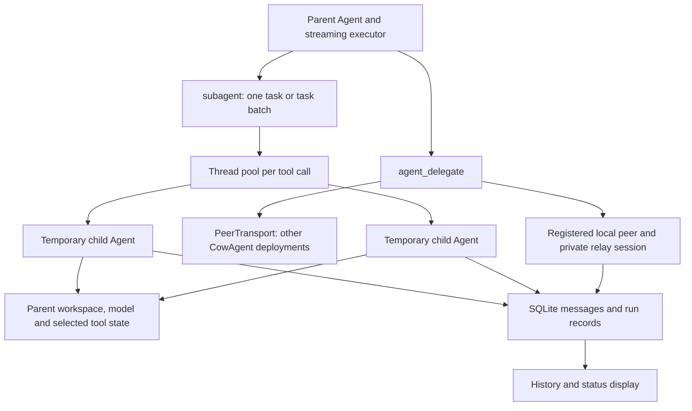

# ORCHESTRATION-001: native multi-agent evaluation

Baseline: fork `hottweelz/CowAgent`, `master` at **`c2c39a2e`**.
Audit branch: `audit/orchestration-001-native`. Evaluated on macOS with the
checkout's Python 3.13 environment. No CowAgent implementation was changed.

CowAgent supports persistent teammate identities, local and remote peer
delegation, and concurrent temporary workers. Its temporary workers share the
parent's process and workspace. Persisted run records support observation, but
do not provide a durable worker queue or checkpoint resume. Task correctness
and hard isolation need additional supervisory controls.

BullGod's comparison criteria here are the capabilities in the audit brief:
delegation, parallel execution, independent workspaces, persistent task state,
recovery, bounded authority and independent verification. No separate BullGod
requirements document was found in the checkout. Proposed priorities below
remain recommendations for review, not implementation authorization.

## Native architecture



These are two different native mechanisms:

| Property | Registered teammate / `agent_delegate` | Temporary `subagent` |
|---|---|---|
| Identity | Stable Agent ID/profile in the team roster. | Template name plus transient run ID; no new registry identity. |
| Creation | Bridge resolves a profile and initializes/caches an Agent per agent/session. | Runner constructs a new Agent for each task in a thread pool. |
| Workspace | Profile's own configured workspace; duplicate profile workspaces are rejected. | Same workspace and project directory as the parent. No automatic worktree/directory per worker. |
| Model | Target's own model setup. | Same model object as the parent. |
| Conversation | Deterministic private relay session per source/target/root session; history can be reused. | Starts with task/context and empty child history. Parent receives the conclusion and structured results. |
| Persistence | Configured profile, conversation/history and run records. | Run row linked to parent; final summary/file references can survive inside the parent's persisted tool result. |
| Isolation | Logical routing/state separation. | Separate Agent/context and shallow tool copies; shared process and underlying resources. |

Source: [team storage](../../agent/team.py#L1),
[registry and workspace validation](../../agent/registry.py#L167),
[bridge runtime cache](../../bridge/agent_bridge.py#L1275),
[relay session and inherited mode](../../agent/tools/agent_delegate/agent_delegate.py#L305),
[child construction](../../agent/subagent/runner.py#L100), and
[template selection](../../agent/subagent/templates.py#L46).

### Configuration, routing and limits

- `agent_delegation`: enabled by default; source-to-target allowlists, conversation
  roster, cycle guards and depth limits. Defaults: depth 3, timeout 600 seconds,
  task/context message bound 8,000 characters. Allowed ranges: depth 1–8,
  timeout 0.01–3,600 seconds, message bound 1–100,000 characters.
  [Policy](../../agent/tools/agent_delegate/agent_delegate.py#L193) and
  [routing guards](../../agent/tools/agent_delegate/agent_delegate.py#L449).
- `subagent`: enabled by default; default depth 1, per-call concurrency 3,
  timeout 300 seconds. Config bounds: depth 1–5, concurrency 1–10, timeout
  10–3,600 seconds. Oversized batches are rejected by the tool. Custom templates
  come from the workspace's `subagents` directory and can replace built-ins.
  [Settings](../../agent/subagent/runner.py#L32),
  [tool guards](../../agent/tools/subagent/subagent.py#L328),
  [template loading](../../agent/subagent/templates.py#L171).
- A child gets half the parent's step limit, at least one step, and the parent's
  context limit. The fixed blocklist removes the `subagent` tool even from an
  all-tools template; peer delegation is governed separately.
- Concurrency is capped **per subagent call**. The parent executor also runs
  parallel-safe calls concurrently, each with its own pool. No shared global
  worker admission limit was found in these paths.
  [Thread pool](../../agent/subagent/runner.py#L309),
  [parallel parent calls](../../agent/protocol/agent_stream.py#L2278).
- Local peer delegation waits for the peer's answer; same-target relay-session
  locking prevents concurrent mutation of that session. Remote delegation uses
  the configured peer transport. [Local path](../../agent/tools/agent_delegate/agent_delegate.py#L581),
  [remote path](../../agent/tools/agent_delegate/agent_delegate.py#L644).

## Controlled runtime evidence

[Results](results.json) are observations from the reproducible [probe](probe.py),
not live-provider performance claims. The probe uses the real Agent/executor,
SubagentTool, runner, native Write/Bash tools and SQLite run store. Only model
responses are deterministic local streams. A barrier requires worker calls to
overlap before either proceeds; artifact contents are checked separately using
independent arithmetic and file reads.

| Case | Demonstrated result |
|---|---|
| Parent delegates two independent fictional tasks | Both completed and wrote valid distinct artifacts. Two different worker threads overlapped in one process and shared workspace. Exact overlap duration is in `parallel`. |
| Two parallel batches, each at limit 2 | Four workers overlapped. All four outputs passed independent checks. The configured limit is not a whole-parent/global cap. |
| Deliberately incorrect outputs | Both workers and run rows reported completed/done, while both independent artifact checks failed. Native completion does not certify correctness. |
| One worker gets a synthetic non-retryable 401 error | One worker completed with a valid artifact; its sibling failed after one model call. Run rows preserved done/failed separately. |
| Synthetic transient 503 error | Each worker recovered through the native retry path and produced a valid artifact. Three calls per worker: failed attempt, tool-producing reply, final reply. |
| Parent cancellation | Runner returned cancelled while the scripted provider call was still blocked. The row was initially running and became cancelled after that worker exited. |
| Deadline | Runner returned timeout while the provider call was still blocked. After release, the persisted terminal row was cancelled, not timeout. This probe compresses the direct runner deadline to 0.3 seconds; it does not exercise the public 10-second minimum. |
| Process stopped during a pending worker, then restarted | A new process read the row as raw running; the history helper interpreted it as interrupted. No worker was automatically dispatched. Explicit resubmission created a new run and left the old row unchanged. |

This demonstrates thread concurrency during waiting/tool work. It is not a CPU
parallelism benchmark or a test of real provider rate limits, shared-client
thread safety, or throughput under load.

### Persistent peer execution

The [peer probe](delegation_probe.py) exercises real local AgentBridge routing,
cache, reply execution, permissions and SQLite history. A safe per-profile
initializer substitutes synthetic models and a local Write tool; bridge
constructor startup and MCP reload are bypassed to avoid scheduler/evolution
startup and service connections.

It routes to two registered workers with separate workspace paths. Worker A
writes independently checked artifacts over two handoffs, reuses its private
session, and retains two done runs and two visible user turns. Worker B inherits
read-only mode and its write is denied. An allowlist subsequently rejects that
target before another model turn. The model can still claim success after a
denied write; the artifact/event checks expose the actual result.

## Persistence, recovery and lifecycle

Profiles live in `agents/team.json`, with legacy config fallback. Runtime Agent
instances, thread pools, futures, cancellation events and in-flight transport
requests are process-local. The run schema records IDs, parent linkage, status,
timestamps and extras. For a temporary worker, extras contain the template name;
the row is not a serialized execution context or replayable task envelope.

Temporary-worker bookkeeping is best effort: a missing workspace or failed
store operation can leave work unrecorded without preventing it from starting.
Completed summaries/files can survive in the parent transcript when the normal
bridge persists that transcript. This is distinct from preserving the child's
full context, active tool state or continuation point.
[Run opening/closing](../../agent/subagent/runner.py#L150),
[run schema](../../agent/memory/conversation_store.py#L95),
[run writes](../../agent/memory/conversation_store.py#L1406), and
[history reconstruction](../../tests/test_subagent_history.py#L1).

The restart test terminates only its own observed-live backend probe process
with a pending real worker, then starts a new backend process on the same
disposable store. The new process reconstructs the Agent and store, reads the
interrupted state, and explicitly submits a new task. It does **not** start the
full web server or exercise a service manager's graceful shutdown hooks.
Source inspection found no worker rescheduling consumer in these paths;
`_live_runs` is an in-memory set and the history layer reinterprets stranded
rows as interrupted. A new user turn may use retained parent history, but that
is not checkpoint resume or an exactly-once execution guarantee.
[Restart status logic](../../agent/memory/conversation_store.py#L1541).

Cancellation and timeout are cooperative. The runner signals child events,
requests wrap-up near the deadline, and returns without waiting for worker
threads to terminate. A blocked provider/tool can outlive the returned status.
The probe releases its blocked fixtures and waits for them to exit; it leaves
no test worker running. Persisted timeout provenance is weak: the measured
timeout later became cancelled. [Lifecycle loop](../../agent/subagent/runner.py#L327).

Provider retries/fallback are request recovery inside a running Agent, not a
durable task retry queue. Retryable primary errors have up to three retries;
fallback links get a single attempt, and a configured backup can bypass the
rate-limit wait. Nested subagents retain the shared parent's fallback scope.
[Retry logic](../../agent/protocol/agent_stream.py#L2028),
[fallback regression tests](../../tests/test_subagent_fallback_scope.py#L1).

## Permissions, memory, skills and workspace access

| Boundary | Source and observed behavior |
|---|---|
| Tool set | Child tools are the template's selection from parent tools, minus `subagent`, `send`, `scheduler`, `env_config`, `evolution_undo`. Explore omits Write/Bash; a scripted attempt to call absent Write failed and created no file. |
| Session mode | Temporary children copy the parent's mode/project directory. General-purpose Write was denied under read-only mode. Persistent local delegation also inherited source mode in the peer probe. |
| File scope | Workspace-write permits explicit write/edit targets within its roots, including the system temp directory; reads are not confined. A direct write outside both the fixture workspace and actual temp root was denied. |
| Shell scope | Argument checks are not an OS sandbox. The same outside-workspace marker was successfully written by a fixed Python program through native Bash, with normal Bash safety mode enabled. |
| Memory | Child `memory_manager` is None, but shallow-copied memory tools retain the parent's manager. The real memory_search tool called a fictional parent manager successfully. No production memory was read. |
| Skills/resources | All-tools templates inherit the same skill-manager reference; narrower templates do not. Tool copies separate mutable execution slots but can share browser/MCP clients and other underlying objects. |
| Persistent-agent state | Profiles have separate workspace paths and scoped memory/skills selection. Shared assets can fall back to the shared root; conversation history uses an Agent-scoped global SQLite store. Separate paths are not OS access controls. |

Evidence: [permission probes](permissions_probe.py),
[shallow copies](../../agent/subagent/runner.py#L86),
[template tool/skill policy](../../agent/subagent/templates.py#L19),
[permission scope](../../agent/permission/policy.py#L1),
[shared/per-agent/per-user state](../../common/state_dir.py#L1), and
[global conversation store](../../agent/memory/conversation_store.py#L2858).

Additional source findings, not separately fault-injected: a permission-check
exception falls through to unrestricted execution; workspace-write allows
unrecognized tool names by default, while read-only applies a name heuristic.
These are insufficient for a hard capability boundary around arbitrary MCP
tools or external programs.
[Fail-open branch](../../agent/protocol/agent_stream.py#L2551),
[unknown tool policy](../../agent/permission/policy.py#L657).

Bash normally inherits the process environment and loads `~/.cow/.env`.
The audit removes provider variables from its environment and redirects only
that `.env` lookup to a known-missing fixture path, keeping HOME unchanged.
Credential isolation is therefore **not** a native-worker property established
by these tests. [Bash environment loading](../../agent/tools/bash/bash.py#L198).

Documentation drift: the [subagent asset guide](../../agent/subagent/assets/README.md#L84)
says memory_search/memory_get are denied; the current template blocklist allows
them. The runtime memory probe agrees with the code. The original guide was not
edited during this audit.

### Approval and supervisor verification

The inspected tool boundary allows or denies according to the selected mode;
denials direct users to change the mode in the console. No per-action approval
queue/token handshake was found in the inspected delegation/permission paths.
Prompt instructions to ask for approval do not create such a gate.
[Permission refusal](../../agent/permission/policy.py#L570),
[executor check](../../agent/protocol/agent_stream.py#L2391).

Parents receive status, summary, duration and sometimes file references, plus
progress events for display. They can inspect outputs with normal tools. There
is no mandatory independent verifier before completed/done is returned. The
wrong-artifact case demonstrates the difference, including durable done rows.
[Result reporting](../../agent/tools/subagent/subagent.py#L375).

## External agent runtimes

The existing extension is `PeerTransport.invoke(InvokeRequest) -> InvokeResult`,
with event callbacks and a peer directory. The console-backed implementation
speaks CowAgent's `agent_invoke` event/result protocol to separate deployments.
Inbound policy limits targets, depth, deadlines and inherited permission mode;
remote callers cannot widen the receiver's global mode.
[Transport contract](../../agent/multiagent/transport.py#L117),
[console adapter](../../common/cloud_client.py#L84),
[inbound policy](../../agent/multiagent/inbound.py#L147).

No native Codex/Claude Code/Gemini CLI adapter was found in this checkout.
Bash/skills or an MCP tool can launch/wrap another program, but that does not
automatically supply identity, lifecycle, approval, cancellation, durable task
state or verified-result integration. An adapter could retain an external
runtime's ownership of its own model, instructions and session, while exposing
a narrow invoke/status/cancel/result contract to CowAgent. That is an extension
proposal, not demonstrated interoperability. No external runtime, service or
production credential was used in this audit.

## Gaps against the supervisory brief and priorities

| Priority | Gap | Recommended next scope and acceptance evidence |
|---|---|---|
| 1 | Workspace/mode checks do not provide hard isolation; shared state and credentials can cross a worker boundary. | Define capabilities per worker; fail closed on permission errors; choose process/container/OS enforcement for untrusted shell/MCP work. A sibling-marker test must fail through both direct tools and arbitrary programs. |
| 2 | Run history lacks durable task inputs, attempts, leases, checkpoint/continuation state and restart reconciliation. | Define a task/attempt state machine with idempotency, replay policy and orphan handling. Crash before/during/after effects and prove recovery without duplicate committed effects. Preserve timeout versus cancellation provenance. |
| 3 | Completed/done does not imply independently verified success. | Add an explicit supervisor verification state and artifact/result contract. Incorrect artifacts and denied writes must prevent verified completion even if a worker claims success. |
| 4 | Per-call pools can exceed intended overall capacity; timed-out calls may still be active. | Add global/per-parent admission and resource budgets plus owned-process termination where required. Test multiple batches and verify resource release before replacement work starts. |
| 5 | External-runtime ownership and approvals are not formalized. | Review a thin runtime adapter and explicit approval protocol before implementation. Preserve external identities/sessions; test invoke/status/cancel/recovery using an owned fixture first. |

Keep durable peer identities and temporary task workers distinct in that design.
Do not add another generic spawning layer before choosing the task state,
authority and verification contracts. No priority above has been implemented.

## Reproduce, evidence and limits

```bash
.venv/bin/python docs/orchestration-001/probe.py --output /private/tmp/orchestration-results.json
```

The probe creates a fresh `/private/tmp/cowagent-orchestration-*` workspace.
It sets an isolated COW_DATA_DIR and synthetic in-memory config, disables
self-evolution, blocks socket connections, and uses fictional files/tasks only.
The receipt records actual Git HEAD and refuses implementation differences from
the audited baseline; docs-only audit commits are allowed. Worker briefs contain
the arithmetic requirements and expected output format. Non-skipped permission
observations must match their asserted outcome or the probe exits with an error.
The outside-workspace checks explicitly test whether their markers also lie
outside the host's allowed system temp root; any skipped boundary probe must
remain a skip, not a pass. The retained receipt has no such skip.

The [existing-test receipt](tests.json) records the focused selection:
**394 passed**, zero failures/skips, with network connections blocked and an
isolated synthetic configuration. Coverage includes registry/routing, local
delegation/timeouts, peer inbound permission policy, worker settings/templates,
history/run records, cancellation, fallback scope and permission parsing.
The audit probes add real-loop observations beyond tests that stub whole child
Agents. Static checks cover all three probe files.

To repeat the recorded regression selection with the same isolation guards:

```bash
COW_DATA_DIR="$(mktemp -d /private/tmp/cowagent-orchestration-tests.XXXXXX)" .venv/bin/python - <<'PY'
import json, logging, os, pathlib, socket, sys
from unittest.mock import patch
logging.disable(logging.CRITICAL)
import config
root = pathlib.Path(os.environ['COW_DATA_DIR'])
config.config = config.Config({'agent_workspace': str(root / 'state'),
                              'self_evolution_enabled': False})
import pytest
files = json.loads(pathlib.Path('docs/orchestration-001/tests.json').read_text())['test_files']
with patch.object(socket.socket, 'connect', side_effect=AssertionError('Audit network disabled')):
    sys.exit(pytest.main(['-q'] + files))
PY
```

One independent evidence review identified underspecified fictional task briefs,
missing top-level permission assertions and a hard-coded source label. The
probes were corrected and rerun. The peer fixture also pins the same synthetic
registry globally and in the bridge, so its SQLite binding matches the native
multi-agent layout. These were audit-fixture corrections, not product fixes.

Limitations: deterministic models prove orchestration paths, not model planning
quality. No live provider, remote peer transport, external CLI agent, full web
server restart, production workload, distributed race or native Windows run was
performed. The process-crash and permission tests have the exact boundaries
described above. Existing SQLite/efficiency work and the separate nine-error
ChannelsPage typecheck baseline were not changed or re-audited here.

Only audit documents/probes/receipts and the handoff ledger belong in this
commit. Existing TestPilot state and configuration are outside the probe paths.
No implementation changes, PR or merge are included. Results must be reviewed
before a follow-up implementation task.
