# ORCHESTRATION-RELEASE-001: integrated release assessment

Decision: **RELEASE READY for the documented restricted-mode scope**.
The nine pre-existing ChannelsPage errors are resolved by the focused
[icon type-contract fix and evidence](../channel-icon-typecheck/README.md).
Strict renderer typecheck now exits zero with strictness unchanged. Actual
icon rendering, all applicable regressions and release gates passed again on
2026-11-07. The original failed gate receipts remain preserved as history.

This report covers the integration of restricted worker authority, durable task
recovery, and independent result verification. The maintainer authorized merging
the verified integration into the fork's master after gate closure. Production
deployment remains separate. The integration branch is
`release/orchestration-release-001`; production was not restarted or modified.

## Source and ancestry

The implementation is a dependency chain, not three independent patches:

| Step | Exact commit |
| --- | --- |
| Fork master baseline | `c2c39a2e0823f1556ecdc79f9e07911fff207a05` |
| Native orchestration audit | `06e0a4ddd0b4512d039d5a2c8e4cd2561c7f44f5` |
| ISOLATION-001 | `5b0bb0be33cbb2604dc80ee43629c1b6f6e316d7` |
| RECOVERY-001 | `8ed52509ddfaebcf271c1f91c1391492f482763e` |
| VERIFICATION-001 | `88151dffda020a36fcff88fa4bdbda5d10f50373` |
| Branch publication preference | `b8b4b40b16a02781044b9e5ab9e7a382974e7ac5` |
| Integrated guest identity and waiter fixes | `0710e8fc0d40935f5b8aabc6b1b9042b6a7d37cb` |
| Channel icon type contract | `9604bde7cacd19aeb914b345dcc5c9ea8616e0e4` |

All three implementation branches matched their tracked origin branches at
the start. Their published GitHub guides were read and their blobs compared
with the checkout. The integration branch was created from current
`origin/master`, then fast-forwarded through the full chain. There were no
cherry-picks, merge conflicts, or edits to master. See [ancestry.json](ancestry.json)
and [published-docs.json](published-docs.json).

The branch adds integrated tests and two corrections found by the independent
review. [Fix implementation](https://github.com/hottweelz/CowAgent/commit/0710e8fc0d40935f5b8aabc6b1b9042b6a7d37cb)
is the tested Python revision. The following evidence commit adds tests,
reproduction commands and this report; it changes no product behavior. The
[published branch](https://github.com/hottweelz/CowAgent/tree/release/orchestration-release-001)
contains both. Source hashes in the regression receipt bind the test result to
the exact tested Python files. The focused icon branch starts at integration
commit `1a64afad5f7d54ff1f20e40eadb1d17370bc8e40` and changes only the local
component type in product code. Integration and master are fast-forwarded to
the verified descendant, preserving the tested product tree.

## Architecture and outcome contract

```mermaid
flowchart LR
  C[Trusted caller and frozen criteria] --> J[Private WAL task journal]
  J --> L[Task and receiver-session locks]
  L --> A[Frozen and current authority intersection]
  A --> W[Fresh restricted worker]
  W --> I[Durable intent before native effect]
  I --> F[Granted text artifact]
  F --> R[Effect receipt and execution commit]
  R --> V[Independent read-only checks]
  V --> O[Separate execution acceptance and state outcomes]
```



The trusted Python host mediates every supported worker tool call. Native
descriptors identify actual implementations; a tool name cannot grant authority.
Filesystem operations use descriptor-relative POSIX access, reject symlinks and
hard links, and exclude private state and executable source. Workers receive
fresh state, explicit roots, and no private teammate history, memory, or skills.
This is a restricted tool boundary, not an OS sandbox for arbitrary code.

The private recovery journal is separate from the memory/history database.
It uses SQLite WAL, FULL synchronous writes, immutable task inputs, per-attempt
records, and full-lifetime task locks. Local delegation also holds a receiver
and session lock. A crash with no mutating intent permits a fresh attempt.
Any mutating intent requires explicit operator acknowledgement before retry.
Completed execution remains terminal even when verification fails.

| Outcome | Evidence |
| --- | --- |
| Execution completed | Attempt-scoped completion committed to the journal. |
| Acceptance passed | Declared criteria pass, with no blocking mutation failure or permission refusal. |
| External state confirmed | Independent native filesystem observation matches the declared state. |

`verified=true` requires all three. Worker prose and successful tool transport
cannot establish them. Native checks are `file_exists`, `text_equals`,
`json_equals`, and `sha256`. Missing or unsupported checks stay unverified.
Reports retain their task, attempt, contract hash, observation time, and history.
Confirmation is time-bound; separate files are not one atomic snapshot.

## Combined process and persistence evidence

All new scenarios use private HOME/data directories, synthetic profiles and
tasks, fake model responses, and denied external network calls. They exercise
the shipped recovery consumer, task store, native tool gateway, file broker,
and independent checker. Assertions inspect database rows and real artifacts.

| Scenario | Required observed result | Test source |
| --- | --- | --- |
| SIGKILL before dispatch | Queued task runs once after restart. | `test_orchestration_release.py` |
| SIGKILL before a tool effect | New safe attempt completes and is independently verified. | Same |
| SIGKILL after durable intent | `needs_review`, no automatic retry, explicit acknowledgement required. | Same |
| SIGKILL after write before receipt | Existing artifact observed; no replay until acknowledged; prior receipt remains uncertain. | Same |
| SIGKILL after completion before verification | Read-only verification completes after restart; no new attempt or write. | Same |
| Repeated restart | Stable attempt, effect and verification counts; no duplicate completed work. | Same |
| Cancellation and timeout during blocked execution | Correct task/attempt provenance persists; live lock prevents retry; restart retains terminal state. | Same |
| Revoke write permission before acknowledged retry | Native write denied, no file effect, acceptance cannot pass. | Same |
| Wrong or missing completed artifact | Completed execution, failed checks, no automatic replay. | Same |
| Sibling read with concurrent consumer | Live task remains owned once; sibling secret never enters requests; allowed output can be confirmed while acceptance fails. | Same |
| Identity/history/index preservation | Both profiles and identity/memory file hashes retained; exact session/message/run rows retained; existing FTS indexes queried without rebuild. | `test_orchestration_persistence_release.py` |

The persistence test reopens both agents' memory managers and calls the normal
owner memory tool. SQL traces require FTS `MATCH` and reject `LIKE` fallback.
Both memory indexes pass WAL/integrity/foreign-key checks. The task journal
also passes those checks and confirms FULL synchronization. Existing isolation
tests repeat memory-manager reopen and indexed retrieval three times.

The [SQLite repair](../memory-sqlite-io.md) is retained unchanged. Its recorded
cause was external backup conflict handling that renamed active WAL companions;
SQLite itself does not create `[conflicted]` names. This release reruns the
synthetic I/O reproduction and storage/history regressions. It does not inspect
or reopen TestPilot's production database or claim a new live TestPilot check.

## Regression and review gates

Final isolated Python regression: **1,364 passed, 15 skipped, zero failures or
errors**, across **119 test files**, in 40.26 seconds. Seven skipped native-browser
cases passed separately with an exact test-ID match. The combined unique result
is **1,371 passed, eight skipped**. The remaining skips are two Windows path
cases and six Windows PowerShell cases; they are not claimed as tested on
macOS. All **54** changed/new Python files passed F-class Ruff and compilation.
See [regression.json](regression.json), [regression-output.txt](regression-output.txt)
and [python-static.json](python-static.json). Focused worker and reviewer runs
overlap this selection and are not added again.

The [native-tool receipt](native-contracts.json) covers all 16 historical native
contracts: Read, Write, Edit, Bash, Ls, Send, SearchFiles, EnvConfig, Scheduler,
WebSearch, WebFetch, Vision, Browser, Time, MemorySearch and MemoryGet. The
fixture uses the real initializer and stream selection path, attaches memory
tools normally, enables anonymous search availability without making a request,
and disables optional subagents for this historical inventory. All 16 parameter
source modules match fork master; exact emitted parameter schemas are pinned.
The 17 raw ToolManager descriptors and two separately attached memory descriptors
are also checked, along with the authorized optional root/verification fields.
Tool availability depends on configuration; 16 is this historical request
inventory, not a universal count of every registered class. Production provider
configuration parity is not claimed.

The original UI gates are preserved in [ui-gates.json](ui-gates.json).
The fresh [gate closure receipt](../channel-icon-typecheck/ui-gates.json) reports
strict renderer **pass (exit 0, no errors)**, desktop build pass and 39 Node
tests passed. The fresh [Python receipt](../channel-icon-typecheck/python-gates.json)
again confirms 1,371 unique passes and eight platform skips. Actual 12-channel
card/dropdown rendering, custom paper planes and the fallback icon passed in
light and dark themes. The independent local type-contract review found no
blocking issue. The earlier gate results below explain the prior blocker:

- Node usage, scroll and message-mutation tests: **39 passed**.
- Desktop `npm run build`: **passed**. Existing font, stale Browserslist,
  mixed-import and bundle-size warnings remain documented in the receipt.
- Strict renderer `tsc --noEmit -p tsconfig.json`: **failed**, exit 2,
  exactly nine TS2322 errors at ChannelsPage lines 57, 59, 60, 61, 62, 63,
  64, 66 and 67. Normalized diagnostics match the recorded baseline hash
  `bf985076359ae7d3974afdbfbdb64738a8a881111d1ace69ff4a81c49f92d297`.
  ChannelsPage source is identical to fork master. No frontend fix or check
  weakening is included.

One independent Sol 6.1 engineering review identified guest execution identity
restoration and stale-waiter cancellation races. The [review record](review.md)
documents their reproductions, fixes, regression coverage, and review limits.
The prior early-return tool-receipt defect is covered by the common stream
result boundary and retained real native rejection cases.

Reproduce the retained Python selection plus release cases with:

```bash
.venv/bin/python docs/orchestration-release-001/run_regression.py
```

The runner clears inherited credentials, assigns private HOME/data, and allows
only HTTP fixture ports registered by the test process. Native browser tests
run separately with fresh profiles and local file fixtures; their valid receipts
are counted once. No provider requests or external-service verifier is used.

## Supported and intentionally unavailable workflows

| Workflow | Status |
| --- | --- |
| Restricted native Read, Write, Edit, Ls and SearchFiles | Supported within explicit grants and regular UTF-8 text limits (2 MiB). |
| Temporary native workers and local delegation | Supported; authority only narrows; private teammate context stays excluded. |
| Safe interrupted native tasks | Automatic new attempt from frozen inputs. No model-token checkpoint resume. |
| Uncertain effects | Operator inspection and explicit acknowledgement required; effects can repeat after that acknowledgement. |
| Re-observe a completed result | Read-only verification; no worker replay. |
| Known native full-access owner tools | Retain privileged host behavior and its authority. |
| Worker Bash/programs/browser/MCP/network/environment/scheduler/evolution | Intentionally unavailable in restricted mode. Requires a separate hard-isolation design where applicable. |
| Remote peer invocation or legacy scheduled tool calls | Denied until enforceable authority propagation exists. |
| Remote-service state, arbitrary executable validators, binary documents or semantic grading | Unverified/unsupported. |
| Windows restricted execution and durable recovery | Unsupported; POSIX locks/file broker required. |

The tested platform is macOS/APFS. Linux needs its own platform run. A malicious
installed extension, compromised Python host, or hostile same-user filesystem
mutation is outside the restricted-worker boundary. No exactly-once guarantee,
hard OS isolation, remote authentication protocol, or forceful termination of a
blocked provider call is claimed.

## Migration, deployment and rollback

No production migration was performed. Existing memory/history data, identity
files, credentials, models, configuration and instructions were not changed.
Self-evolution stays disabled in every synthetic fixture. No dependency was
installed for this release review.

Before a separately authorized deployment:

1. Retain the passing renderer gate and review this report's platform and
   workflow limits. All required integration gates now pass; deployment still
   requires its own controlled maintenance authorization.
2. Stop the old runtime in a controlled maintenance window. Inspect pending
   tasks and retain artifacts. Do not run old and new consumers against the
   same live journal.
3. Keep the live memory and recovery databases, companions and lock directory
   outside file-sync conflict handlers. Use SQLite's backup API for consistent
   backup artifacts. Do not delete, rename, or copy only a live main DB.
4. Preserve the existing journal. The retry-generation column is added
   transactionally with default zero; existing task rows remain intact. Older envelopes
   that already recorded a guest as the host cannot be reliably repaired from
   their frozen data; inspect any such pre-fix pending work before enabling
   recovery, and recreate only after confirming prior effects. No automatic
   identity rewrite or production journal rebuild is performed.
5. On the target installation, verify initialization, indexed retrieval,
   task recovery and scoped identity behavior before normal use. These private
   fixtures do not certify that installation or its model provider.

For rollback, stop the new runtime, retain the journal and all task artifacts,
and inspect queued/running/uncertain work before selecting prior code. Earlier
code cannot reconcile this queue and may report execution without verification.
Reverting isolation restores documented permissive behavior; do not expose
untrusted workers to it. Do not restore a stale memory/history copy over newer
writes. No master merge or runtime change must be undone from this review.

## Safe branch state

The release candidate and report are published on the dedicated integration
branch. The maintainer-authorized merge advances master from the recorded
baseline to the verified descendant. The four pre-existing untracked
files (`AGENTS.md` and three conflicted PID files) are excluded from all commits.
The branch tracks the same name on `origin` (`hottweelz/CowAgent`). Publication
is checked with `git fetch origin --prune` and
`git rev-list --left-right --count HEAD...@{u}`; the final handoff reports that
result and the report commit. The previous blocker is closed; the documented
restricted execution and deployment limits continue to apply.
