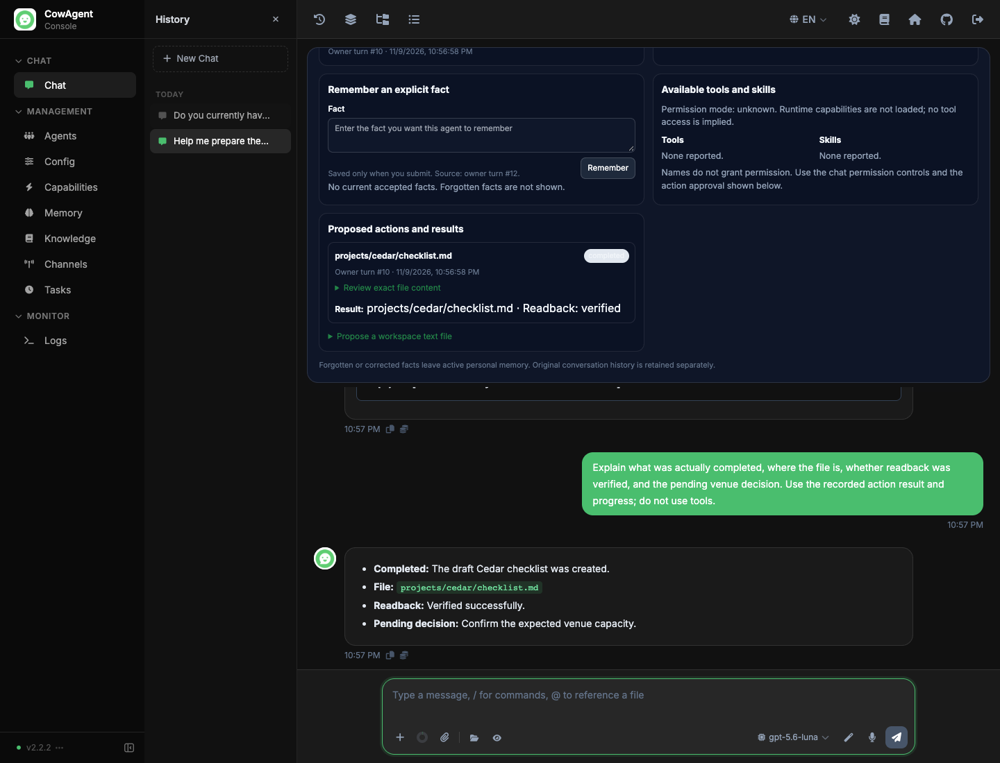

# PERSONAL-001: Identity and Persistent Memory

BullGod can keep an owner-confirmed goal and useful facts across conversations,
process restarts and model changes. The existing chat now has a continuity card
for the goal, progress, pending decision, next step, memory sources and action
results. Specialist agents are not required.

This work starts from PR #8's normal merge, `1cc6ef1e`. The integration check
confirmed an identical tree to reviewed head `a2994b1a`, matching regression and
development evidence hashes, no unresolved review threads and no CI/dependency
changes. The retained local regression qualified that merge; no hosted result
was inferred from GitHub's empty check list. PRs #4–7 remain preserved.

## Use the first experience

1. Start a dedicated development instance and sign in. Talk to BullGod about a
   goal, such as a fictional workshop checklist. Its persona lives in its native
   workspace, independently of the model.
2. Open the continuity card. Confirm the goal, progress, pending decision and
   next step, then select **Save goal**. The record cites a real owner message.
3. Use **Remember** for an explicit fact. **Correct** changes the current fact;
   **Forget** removes it from active personal context. Sources and times remain
   visible. Original conversation transcripts are retained separately.
4. Stop and restart the isolated instance. Reopen the conversation, or resume a
   recent goal from another conversation. Current accepted records reload for
   every native owner turn. Changing the model does not change their ownership.
5. Ask BullGod for a useful next action. Review the actual runtime tool/skill
   list and permission limits. To write a text file, create a proposal with the
   exact workspace path and content. Creating the proposal does not write it.
6. Select **Approve and execute once**, or **Deny**. An approved action left over
   after restart still needs an explicit execute click. The card shows the
   verified result, failure or unresolved state. Ask BullGod to explain it.

The owner controls what becomes accepted memory and a commitment. Model text
does not approve actions or silently save personal facts. This first slice uses
explicit forms in the existing conversation; it does not add a proactive loop.

## Storage and execution boundaries

`agent/memory/personal.py` adds small tables to the existing native conversation
database. Rows are scoped by the native store's agent ID. Goals also have session
IDs and revisions; memories carry owner-turn provenance and correction times.
Current retrieval uses accepted facts and the latest goal for each relevant
session, never old fact revisions or forgotten text. Original transcripts and
legacy file-based memory remain separate; this is not a claim of secure erasure
from backups or all historical records.

`agent/memory/personal_context.py` refreshes this context each native owner turn.
Restricted workers, unbound runtimes and guest speakers do not receive it.
Context is data, not execution authority. A storage failure is reported as
unavailable context rather than pretending that saved state was retrieved.

`channel/web/api/personal.py` requires an authenticated console owner, an explicit
enabled agent and an existing session owned by that agent. Mutations use JSON
and reject cross-origin requests. A password-disabled console cannot use these
owner routes. Unknown identities never fall back to the default agent.

`agent/personal/service.py` binds a write proposal to its native agent/session,
source turn, canonical workspace, exact path/content and expiry. Approval cannot
change that binding. The action is claimed once in a SQLite transaction before
the native permission gateway invokes Write and Read through FileBroker. The
whole saved text is checked against the expected digest before reporting success.
No broad session permission change is saved. Private paths, sibling agent state,
symlinks and out-of-workspace targets retain their existing restrictions.

Personal writes use `synchronous=FULL`; the native conversation connection policy
is unchanged. Expiry is evaluated after the database grants its writer lock.
Executing, completed, denied, expired and failed actions are never automatically
replayed. An executing action left after interruption remains unresolved; a failed
verification may follow a file effect, so the card requires review rather than a
silent retry. No power-cut experiment is claimed.

## Separate development with the Pooler

The default launcher still denies all outbound networking. A model connection is
an explicit opt-in to one loopback gateway. For this host's existing Pooler:

```sh
python3 scripts/bullgod_dev.py init \
  --python '/absolute/path/to/cowagent/.venv/bin/python' \
  --model-base http://127.0.0.1:4000/backend-api/codex \
  --model gpt-6-luna
# Set open_ai_api_type to "responses" in this new root's data/config.json
# before starting it. Keep all other generated fields, including its password.
python3 scripts/bullgod_dev.py start /absolute/root/printed/by/init
python3 scripts/bullgod_dev.py stop /absolute/root/printed/by/init
```

The selected gateway credential variable must exist when **start** runs. Its
name defaults to `CODEX_POOLER_API_KEY`; `--model-key-env` selects another name
at initialization. No credential value is accepted on the command line or saved
in the instance. The bootstrap removes the temporary transport variable before
application initialization and supplies the value only to HTTP headers for the
selected gateway base. It never enters the application config or its config log.
No upstream OAuth tokens are copied or changed.

Each instance has private source, data, workspace, profile, console password and
conversation state. The web console uses 19892 by default; live CowAgent's 9899
is explicitly rejected. The sandbox permits only the selected gateway's port in
addition to the console's inbound port. Runtime dependencies and same-account
processes remain trusted. Create a new root for a new source snapshot or reset;
temporary roots are not production storage. See the [launcher procedure](../bullgod-reset-001/development.md).

## Validation

The [implementation plan](plan.md) gives the scope and ownership. The [acceptance procedure](acceptance.md) and source-bound results in this directory distinguish storage/API tests,
real model conversation, browser behavior, restart/model continuity, full local
regression and hosted availability. No live service update is part of this work.

Independent source review closed the expiry, stale-response and durable-claim
findings. A final targeted review also confirmed the quoted-attribute escaping
fix. Focused tests cover those fixes and the native boundaries.

One full guarded macOS/Python 3.13.1 run passed **6,027 tests and 93 subtests**,
with 36 skipped and no failures/errors. The [local receipt](local-validation.json)
lists exact skips and unchanged hashes for all 22 changed source/test files
during that run. A later UI-only quote fix has separate final hashes, Node checks,
12 passing asset tests, independent review and an actual browser DOM check.
Python source stayed unchanged; the full suite was not repeated.
The focused integration selection passed 54 Python tests, and
`node channel/web/tools/check-personal-ui.mjs` passed the sequence-zero, escaped
content, permissions and stale-response cases. Ruff F checks passed. Hosted,
Linux and Windows execution are not claimed for this candidate.

The [native receipt](native-validation.json) records real GPT-6 Luna conversation
through the existing Pooler, restart continuity, a GPT-5.6 Luna model change,
correction and forgetting, the available tools/skills, pre-approval denial, one
approved native file write with readback, saved progress and a natural result
explanation. A final restart retained the completed record and refused duplicate
execution without changing the file or goal revision. Both owned instances and
the test browser are stopped.

The early test helper failed at fixture boundaries. Accepted interactions were
preserved and completed in the same sessions. Its exact source is retained as
[historical reference](reference/acceptance-attempt.py.txt), not a supported test
entry point. An ambiguous model response about the old goal wording remains in
the receipt; an explicit query and a [current-context probe](context-delivery-probe.json)
confirmed the corrected fact. The final browser used an explicit overlay of the
last `personal.js` revision for the quoted-input and restored-history checks;
earlier ordinary-content interactions used the preceding UI revision. The
backend snapshot is unchanged. No model turn was repeated just for bookkeeping.



Next product milestone: PERSONAL-002 can extend this small continuity record into
explicit priorities and multiple commitments. Keep the existing storage and
permission mechanisms; do not make legacy service migration a development gate.
